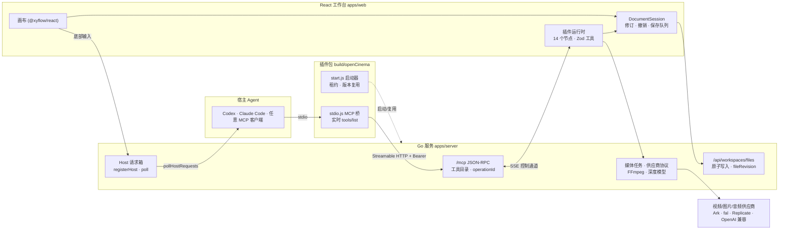

# OpenCinema 架构

本文描述 0.4.0 代码库的实际结构、关键契约与工程评估。内容来自对 `apps/`、`packages/` 与 `docs/` 的通读，文中引用的路径均相对仓库根目录；评估部分是建议，不代表已决定的路线。

## 1. 一句话模型

OpenCinema 是一个**本机运行**的视频创作工作台：Go 服务负责授权、文件、任务与 MCP 入口；React 画布负责一切编辑与节点逻辑；你的 Agent（Codex、Claude Code 或任何 MCP 宿主）通过 MCP 发现并调用同一套工具。**没有打开的 React 页面，Agent 就不能编辑画布**：Go 只做校验与转发，真正执行节点操作的是浏览器中的插件运行时。

## 2. 运行拓扑

三种页面形态共用同一套代码：

| 形态 | 入口 | 与 Go 的通信 |
| --- | --- | --- |
| 普通 Web | `http://127.0.0.1:47920` | 直接 `fetch`/axios，同源 + 回环信任 |
| MCP Apps Widget | `renderOpenCinema` 返回的 `ui://` 资源 | 整个工作台内联进单个 HTML，所有 `/api/*` 通过 `openCinemaTransport` 工具隧道回 Go |
| 通用 iframe | `window.openCinemaHostBridge` | postMessage 宿主适配器 |

## 3. 组件与职责

### 3.1 Go 服务（`apps/server/go`，32 个文件，约 1.4 万行，仅标准库）

| 模块 | 文件 | 职责 |
| --- | --- | --- |
| 核心与路由 | `main.go` | 启动参数、信任分层（回环 / `appRequest` / `localRequest` / Bearer）、顶层路由、错误映射 |
| 生命周期 | `managedRuntime.go` | `.runtimeLock` 独占锁、`runtime.json`（0600）、60 秒运行租约、空闲退出 |
| 工作区文件 | `workspaceFiles.go` | 路径边界、原子写入（临时文件 + fsync + rename）、SHA 修订、导出/恢复 ZIP |
| MCP | `mcpControl.go` `mcpToolDirectory.go` `mcpOperations.go` `mcpContracts.go` `mcpFiles.go` | `/mcp` JSON-RPC、SSE 控制通道、核心工具（≤40）与 `getWorkbenchTools` 二级发现、`operationId` 持久记录、结构化错误 |
| Host 请求箱 | `hostRequests.go` | 底部输入 → 外部 Agent 的队列，60–900 秒租约 |
| Widget | `widgetRuntime.go` `widgetTransport.go` | 24 小时会话授权、`openCinemaTransport` 白名单隧道 |
| 媒体 | `mediaRuntime.go` `videoProvider.go` `videoProviderTasks.go` `arkVideoReference.go` 等 | 供应商注册、SSRF 防护的出站客户端、任务持久化与重启恢复、Ark 参考上传 |
| 本地工具 | `ffmpegRuntime.go` `referenceDepth.go` `depthPreparation.go` | FFmpeg 定位/下载/白名单执行；Video Depth Anything 的 venv、权重校验与推理管线 |
| 协作 | `collaborationRuntime.go` | 房间、三方合并、按人撤销、崩溃日志 |
| 插件 | `plugins.go` `pluginModules.go` | 内置 14 个节点目录、内容寻址的 ESM 插件安装与分发、全局素材库 |

### 3.2 React 工作台（`apps/web`）

- **画布**：`@xyflow/react` 受控模式，单一节点类型 `workbenchNode`，每个插件的 React 视图通过 portal 挂进节点框；展开编辑器时 DOM 被整体搬移，WebGL 等状态不丢失（`workbench/nodeView.tsx`）。
- **控制器**：`lib/workbenchController.ts` 是一个约 2,300 行的闭包，持有编辑会话、插件运行时、宿主适配器，并实现分组、重挂父级、复制粘贴、整理、批量连线等画布语义。UI 手势、插件视图与 Agent 工具调用最终都走同一个 `execute()`。
- **工具目录**：`lib/workbenchTools.ts` 与 `packages/tools/canvas` 用 Zod 定义全部工具，`z.toJSONSchema` 生成 JSON Schema，构建期写入 `widgetResource.json`，再由 Go 对外发布。Schema 只有一个来源。
- **宿主接入**：`lib/workbenchHost.ts` 打开 SSE 控制通道并执行 Go 转发来的调用；`lib/webHost.ts` 以 2 秒轮询 Host 会话、800 毫秒轮询请求状态。

### 3.3 编辑会话（`packages/workbenchCore`，约 400 行，仅依赖 Zod）

- 文档模型 `{toonflowCanvas:true, nodes, edges, viewport}`，上限 1 万节点、2 万连线；解析时拒绝重复 ID、悬空连线与分组环。
- 9 条命令加 `batch`，每条可带 `expectedRevision`；`batch` 原子提交并只产生一条历史。
- 100 份完整快照的撤销/重做；运行时回执会回写进每一帧历史，撤销不会复活过期任务。
- `dirty`/`saving`/`savedRevision` 与共享保存队列；写入失败保留内容与错误。

### 3.4 节点 SDK（`packages/nodeScaffold`）与共享业务（`packages/nodeShared`）

一个节点就是一个 `NodePluginDefinition`：`id`、`view`、`createData`（含端口）、`canConnect`、`composer`、`activate(ctx)`。`activate` 里用 `registerTool` 发布带 Zod 参数的工具；插件自己的 UI 通过 `callNodeTool` 调同一个工具，Agent 通过 `getNodeTools → nodeTools` 调同一个工具。构建由 `createNodeConfig` 完成：React 与 Zod 走宿主的 `/pluginSdk.js`，产物是带 SHA-256 的 `install.json`。

`nodeShared` 承载跨插件业务：生成与参考（`reactGeneration.ts`、`reactReferences.ts`）、媒体编辑（`reactMediaActions.ts`）、镜头计划与审片（`videoShot.ts`）、剪辑计划（`videoEditPlan.ts`）、主题 SCSS。

### 3.5 MCP 桥与插件包（`packages/mcp`、`packages/openCinema`）

- `stdio.ts` 用官方 SDK 做 stdio 服务端 + Streamable HTTP 客户端，每次 `tools/list` 都向 Go 刷新，不缓存；`runtime.json` 变化即重连并发 `tools/list_changed`。
- `start.ts` 校验并复制运行包到 `runtimeBuilds/<revision>`，只复用 revision 完全一致的实例，不抢锁、不杀进程。
- 工具分三层：核心工具（`getAppState`、画布读写、文件、操作查询）、`getWorkbenchTools` 发现的约 57 个扩展操作、`getNodeTools`/`getWorkspaceTools` 发现的插件函数（镜头计划、生成、审片、剪辑计划都在这一层）。

## 4. 关键契约

| 契约 | 作用 | 位置 |
| --- | --- | --- |
| `documentRevision` → `expectedRevision` | 画布乐观并发 | React `DocumentSession` |
| `fileRevision` / `sourceRevision` | 磁盘内容与媒体快照身份 | Go `workspaceFiles.go`、`mcpFiles.go` |
| `toolCatalogVersion` / `catalogRevision` | 动态工具目录绑定 | React 运行时 / Go 工具目录 |
| `operationId` | 有副作用调用的幂等重放；同 ID 不同参数拒绝；重启后未收尾为 `unknown` | Go `mcpOperations.go` |
| `taskId` | 专业异步任务（生成、深度、FFmpeg）的独立跟踪 | 各插件 / Go 媒体任务 |
| 审片六项 | `direction` `action` `identity` `continuity` `unwantedCuts` `artifacts` 全部 pass/notApplicable 且有笔记才可 `approved`；同修订冲突拒收优先 | `nodeShared/videoShot.ts` |
| 剪辑计划 | 2–16 镜，按 `expectedPlanRevision` 整体保存，`canRender` 只判定技术就绪与已审范围 | `nodeShared/videoEditPlan.ts` |

错误统一为 `{code, message, phase, target, executionState, recovery}`；`accepted` 不等于完成，`unknown` 不自动重试。

## 5. 数据与安全边界

- 数据目录（0700）：`settings.json`（凭据，0600）、`workspaces/`、`mcpOperations/`、`mediaTasks/`、`nodes/`、`assets/`、`ffmpeg/`、`.models/`、`.runtimeLock/`、`runtime.json`。
- 工程就是任意目录；画布是顶层 `toonflowCanvas:true` 的 JSON；生成产物在 `assets/<nodeId>/`。
- 路径只接受相对路径，逐级拒绝符号链接；输出只新建不覆盖；导出 ZIP 带逐项 SHA。
- 出站 HTTP 拒绝回环/私网/链路本地；Ark 固定官方域名；临时签名 URL 仅在内存。
- 凭据只在本机设置面板录入，Agent 只能看到 `credentialConfigured`。
- FFmpeg 按平台 SHA 固定；深度模型源码、权重按 commit/SHA 固定，`python -I` 与 `weights_only=True`。

## 6. 构建与发行

`bun run build` 依次执行 Web（Vite）→ 14 个节点包 → MCP Widget 与 stdio → Go（仅本机平台）→ 插件目录装配，产物 `build/openCinema` 含 `release.json`，其 SHA 即 `runtimeRevision`。`bun run release` 只打包已有构建，输出 ZIP、校验和与清单；CI 为手动触发的 macOS/Linux 打包，不跑类型检查与测试。运行发行包只需要 Node.js 22+。

## 7. 评估

### 7.1 做得好的地方

1. **副作用处理极其克制。** `operationId` 幂等、`unknown` 独立状态、先持久化再提交、取消与终止分开，错误自带恢复动作。这是多数 Agent 工具链缺失的部分。
2. **一个真相源。** Zod → JSON Schema → `widgetResource.json` → Go → stdio；手工与 Agent 共用同一条命令路径与撤销历史。
3. **诚实的能力声明。** 代码与文档反复区分"配置了凭据"≠"已鉴权"、"生成完成"≠"审片通过"、"白模参考"≠"运动控制"、"Go 在线"≠"Agent 在线"。
4. **本机安全底线扎实。** 0600 运行信息、`O_NOFOLLOW`、常量时间比较、同源检查、SSRF 防护、内容寻址运行包。
5. **插件生命周期稳健。** 新实例先激活再释放旧实例、撤销/删除前的预检、超时后的补偿释放。

### 7.2 主要风险（按优先级）

1. **信任完全建立在"回环即本机"上。** 任何本机进程都能伪造 `Origin` 与 `X-Toonflow-Workspace` 头成为 `localRequest`，读取未脱敏的 `settings.json`（含 MCP 令牌与供应商密钥），并通过 `/api/workspaces/files/*?directory=/` 读写服务进程可达的任意文件。共享机器上这是实际漏洞。
2. **没有工程目录白名单。** 默认 `-local=true` 下持有令牌的 MCP 客户端可操作任意绝对目录。
3. **执行引擎是浏览器标签页。** 无页面则 Agent 只能动文件；每连接一次只允许一个调用、120 秒超时；关闭标签页会留下 `unknown`。分组、整理依赖 DOM 测量，无法无头复用或测试。
4. **崩溃后需要人工清锁。** 任务未在 10 秒内收尾时 `.runtimeLock`/`runtime.json` 被保留，下次启动失败，没有过期 PID 接管。开发模式 `bun start` 同样会在 `./data` 留锁。
5. **写操作记录达到 1 万条后永久停止**（`mcpOperations.go`），记录不过期；`mediaTasks/` 与内存中的 `depthTasks`、`mediaAccounts` 也不清理。
6. **try-lock 直接返回 409。** 读操作也取锁，生成期间锁住 `assets/<nodeId>` 最长 30 分钟，并发操作与导出得到 `EBUSY` 而不是排队。
7. **两份"巨型对象"。** `workbenchController.ts`（约 2,300 行、25 个可变 Map/Set、两段近 300 行的 if/else 分发）与 `workbench/index.tsx`（约 1,100 行、40 个 `useState`）。Go 侧 `mediaRuntime.go` 1,700 行混合路由、注册表、校验与五套近似的提交/轮询循环。
8. **性能隐患。** 拖动时每帧重建所有节点对象且无 `memo`，WebGL 视图随之重渲染；媒体预览整文件下载为 Blob（视频上限 2 GiB）；每条命令对整份文档做多次 Zod 解析与序列化；每次视口变化 800 毫秒后重写整份画布 JSON；`settings()` 每请求 JSON 往返克隆。
9. **验证手段只有类型检查与手工。** `contributing.md` 明确不新增测试；CI 不跑 `typecheck`/`go vet`。指纹、三方合并、恢复逻辑等契约密集代码没有回归保护。
10. **Widget 会话令牌依赖宿主遵守 `_meta`/`visibility:["app"]`**；拿到令牌即可调用 `nodes/install`、`providers/media/*` 等本机信任端点。
11. **供应链。** pip 仅按版本固定而非哈希；FFmpeg 经第三方镜像拉取（依赖 SHA 校验兜底）。
12. **命名与文档漂移。** `@toonflow/*` 包名、`X-Toonflow-*` 头、`api.toonflow.net` 默认域；`/api/hello` 报 0.3.0；节点 `version` 与 `package.json` 不一致；`director3dNode` readme 与实现不符；`videoDepthNode` 无 readme；全部字符串硬编码中文，无国际化路径。

### 7.3 建议的下一步（按投入产出）

1. **引入工程目录授权表**（Go 内持久化、设置面板可见），`localRequest` 只能打开已授权目录；`/api/settings/get` 对页面也脱敏，令牌改由启动器注入。
2. **锁与记录治理**：过期 PID 接管、`mcpOperations` 按时间/数量滚动、`mediaTasks` 归档、读操作不取排他锁、写锁改为有界等待。
3. **把画布语义从 React 闭包下沉到 `workbenchCore`**（分组/重挂/复制/整理），DOM 测量改为可注入的尺寸提供者；这同时解决"无头不可用"与可测性。
4. **渲染性能三件事**：`NodeView` 用 `memo` 并按 id 稳定 `data` 引用；`onlyRenderVisibleElements`；媒体预览按需加载与 Range 请求。
5. **工具描述与错误消息抽成资源表**，先做 zh/en 两套；这既是国际化，也直接减少 Agent 每次读取的 token。
6. **最低限度的回归保护**：即便维持"仓库不加测试"的政策，也建议至少让 CI 跑 `typecheck` 与 `go vet`，并为 `workbenchCore`、`videoShot`、`videoEditPlan`、`mcpOperations` 这类纯函数模块保留一份可复现实例脚本。
7. **清理遗留命名与版本来源**：统一从 `package.json` 注入版本，移除 `0.3.0` 与硬编码的 `0.4.0` 字面量，逐步替换 Toonflow 命名。

## 8. 快速导航

| 想了解 | 看这里 |
| --- | --- |
| 从源码构建、开发模式 | [`contributing.md`](../contributing.md) |
| 接入 Claude Code | [`docs/claudeSetup.md`](claudeSetup.md) |
| 视频供应商与参考职责 | [`docs/videoProvider.md`](videoProvider.md) |
| 镜头计划、审片门槛、剪辑计划 | [`docs/videoShotWorkflow.md`](videoShotWorkflow.md) |
| 发行归档 | [`docs/releaseGuide.md`](releaseGuide.md) |
| 写一个节点 | [`packages/nodeScaffold/readme.md`](../packages/nodeScaffold/readme.md) |
| MCP 工具契约 | [`packages/mcp/README.md`](../packages/mcp/README.md) · [`packages/openCinema/readme.md`](../packages/openCinema/readme.md) |
| 编辑会话内核 | [`packages/workbenchCore/readme.md`](../packages/workbenchCore/readme.md) |
