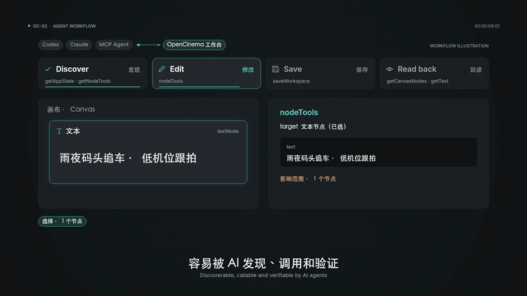
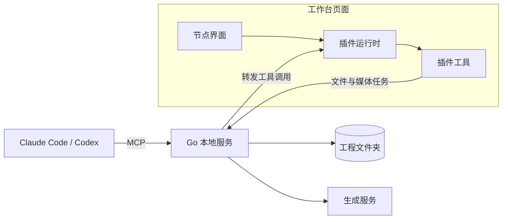

<p align="center">
  <picture>
    <source media="(prefers-color-scheme: dark)" srcset="assets/brand/logoDark.png">
    
  </picture>
</p>

<h3 align="center">从想法到成片，与 Agent 一起掌镜。</h3>

<p align="center">
  本地优先的 AI 视频创作工作台。一张画布连接分镜、素材、白模预演、生成与剪辑，<br>
  你手动做的每一步，Agent 都能用同一套工具接着做。
</p>

<p align="center">
  <a href="#快速开始">快速开始</a> ·
  <a href="#功能">功能</a> ·
  <a href="#开发插件与贡献代码">开发插件</a> ·
  <a href="docs/claudeSetup.md">Claude 接入</a> ·
  <a href="readmeEn.md">English</a> ·
  <a href="LICENSE">MIT</a>
</p>

<p align="center">
  <a href="assets/promo/openCinemaPromo.mp4">
    
  </a>
</p>

<p align="center"><sub>产品动效演绎；实际生成效果依所选模型、参考与审片结果而定。</sub></p>

## 为什么用 OpenCinema

生成工具回答“这段画面怎么生成”，OpenCinema 回答“这部片子怎么做完”。

- **先预演，再生成，只返修需要的镜头。** 用 3D 白模定走位和机位，审片后替换单镜，不用整片重来。
- **从分镜到成片在一张画布上。** 镜头计划、候选审片和剪辑计划连在一起，多个镜头按同一套流程推进。
- **生成后端可以换。** 云端模型、本地服务和你现有的 ComfyUI 工作流，都能接到同一个生成节点上。

工程是磁盘上的普通文件夹，手工操作和 Agent 共用同一套工具，凭据只留在本机。

当前版本 **0.4.0 · 开发中**，尚未发布正式版本，已知限制见[下文](#已知限制)。

## 快速开始

### 1. 准备环境

| 工具 | 版本 | 用途 |
| --- | --- | --- |
| [Bun](https://bun.sh) | 1.3.14+ | 安装依赖、构建前端和插件 |
| [Go](https://go.dev/dl/) | 1.26+ | 编译本地服务 |
| [Node.js](https://nodejs.org) | 22+ | 仅接入 Claude Code／Codex 时需要 |
| FFmpeg | 可选 | 音视频处理；没有的话可在工作台 **设置 → FFmpeg** 中下载 |

### 2. 构建并启动

```bash
git clone https://github.com/junjamrk/OpenCinema.git
cd OpenCinema
bun install --frozen-lockfile
bun run build
bun start
```

打开 <http://127.0.0.1:47920>。服务只监听本机，配置和密钥保存在仓库下的 `data/`（已被 Git 忽略）。

### 3. 打开工程

点击 **打开工程**，填写一个已存在文件夹的绝对路径，例如 `/Users/me/Movies/myFilm`。空文件夹也可以，会自动创建第一张画布。之后可以从首页的 **最近工程** 一键回到它。

### 4. 选一种生成方式

两种方式可以同时用，节点上随时切换。

| | 配置媒体服务 | 连接 Agent |
| --- | --- | --- |
| 适合 | 直接调用模型生成 | 让 Agent 规划、搭画布、批量操作 |
| 需要 | 供应商 API Key 或本地服务 | Claude Code 或 Codex |
| 费用 | 由供应商按量收取 | 宿主订阅不包含所有视频模型 |

**配置媒体服务**

1. 打开 **设置 → 媒体服务**，列表会显示每个供应商是否已配置。
2. 选择供应商，填写 API Key，点击 **保存连接配置**。
3. 在生成节点上点击参数按钮，选择模型。

**连接 Agent**

在完成构建的仓库根目录运行：

```bash
claude --plugin-dir ./build/openCinema
```

Codex 使用：

```bash
codex plugin marketplace add . --json
```

```bash
codex plugin add opencinema@openCinemaStandalone --json
```

然后告诉 Agent「连接 OpenCinema 工作台」（Claude Code 可以直接用 `/opencinema:opencinema`）。工作台右上角显示已连接后，底部输入框的要求就会交给 Agent 执行。其他 MCP 宿主在 **设置 → 宿主 Agent → 其他 MCP 宿主** 复制连接配置，细节见 [Claude 接入](docs/claudeSetup.md)。

> 保持工作台页面打开。画布和节点工具运行在页面里，Agent 通过它操作画布。

### 5. 做第一个镜头

1. 把一张图片拖到画布上。
2. 按 `Tab`，选择 **视频生成**。
3. 从图片节点右侧的端口拖一条线到视频生成节点左侧。
4. 选中视频生成节点，点击上方的参数按钮，选模型、时长和画幅。
5. 在底部输入框写下镜头要求，按 `⌘/Ctrl + Enter` 发送。

节点会显示进度，完成后视频保存到工程的 `assets/`。播放确认后，可以继续截帧、审片，或接到下一个节点。

### 遇到问题

| 现象 | 处理 |
| --- | --- |
| 发送按钮是灰的 | 看输入框下方的提示，直接点 **连接 Agent** 或 **配置模型** |
| 节点里没有可选模型 | 到 **设置 → 媒体服务** 配置，或添加自定义供应商 |
| 音视频处理报错 | 到 **设置 → FFmpeg** 下载，或切换为系统安装版 |
| 端口 47920 被占用 | 运行 `build/server/openCinema -listen 127.0.0.1:47921 -webRoot build/web -dataDirectory data` |
| Agent 报“请先连接工作台” | 打开工作台页面并进入工程，再让 Agent 重新读取状态 |

## 功能

### 节点一览

| 节点 | 能做什么 |
| --- | --- |
| **文本** | Markdown 剧本与说明，富文本和原文两种编辑模式 |
| **图片** | 局部重绘、裁剪、宫格切分、打光、机位、全景 |
| **视频** | 截帧、裁切、变速、提取音轨、分离音视频、审片、语音转写 |
| **音频** | 波形剪辑、片段拼接、变速、语音转写 |
| **图片生成** | 提示词加参考图生成图片，也承接局部重绘、打光和机位草稿 |
| **视频生成** | 文生视频、单图、首尾帧、多模态参考；含镜头计划和候选审片 |
| **音频生成** | 由文本或参考素材生成配音与音效 |
| **Blockout** | 3D 编排场景、走位和摄影机，导出 RGB／Depth 参考与 Animatic |
| **3D 导演** | 用文字生成场景、动作和运镜，手动取景后导出关键帧或视频 |
| **视频分析** | 本地检测切点，输出关键帧、镜头片段和音轨 |
| **媒体信息** | 本地读取编码、时长、帧率、轨道，不上传文件 |
| **Motion** | 分析二维运动、姿态和相对深度，导出制作参考包 |
| **视频深度白模** | 用本地模型把视频转成深度参考 |

另有工作区扩展 **多人协作**，详见[协作与工程管理](#协作与工程管理)。

### 画布

- 多画布、画布文件夹、节点分组与合并，保存状态实时显示。
- 拖入文件或粘贴内容自动建节点；从端口拖到空白处，只列出能连接的节点类型。
- 框选后批量排列、批量连接，或拖到空白处创建并连接新节点。
- 对齐参考线、网格吸附、导航地图、自动整理、连线高亮。
- 工程级撤销重做，按住 `Alt` 拖动复制节点。
- 快捷键和节点菜单都可以在设置中自定义。

常用快捷键：`Tab` 添加节点、`⌘/Ctrl + F` 搜索节点、`V` 选择、`H` 抓手、按住 `Space` 平移、`⌘/Ctrl + G` 成组、`Alt + Shift + F` 整理画布。

### 图片编辑

选中图片节点，点击工具栏的画笔按钮打开编辑台。所有操作都生成新副本，原图保留。

- **局部重绘**：画笔或框选区域，生成蒙版后描述要求，结果只替换选中部分。
- **标记**：画笔、矩形、圆形、文字、橡皮擦，可保存为标注副本。
- **裁剪与变换**：固定比例裁剪、像素级参数、旋转、翻转。
- **宫格切分**：把分镜拼图切成独立图片并自动成组。
- **打光与机位**：在 3D 场景里调整光位或相机，转成生成草稿。
- **全景**：球面或柱面投影，截取 1／4／12 个视角，支持镜头、透视和接缝校正。

编辑台支持缩放（`⌘/Ctrl + 滚轮`、`+`、`−`、`0`）、工具快捷键（`B` 画笔、`R` 矩形、`C` 圆形、`T` 文字、`E` 橡皮，`[` `]` 调笔宽）和独立的撤销重做。

### 生成与供应商

图片、视频和音频生成都有两条路：交给宿主 Agent，或直接调用配置好的模型。

| 供应商 | 图片 | 视频 | 音频 | 说明 |
| --- | --- | --- | --- | --- |
| TF-router | ✓ | ✓ | ✓ | 支持报价和余额查询 |
| APIMart | ✓ | ✓ | | |
| 优云智算 | ✓ | ✓ | | |
| 秘塔 MiniMax H3 | | ✓ | | |
| 火山方舟 Seedance | | ✓ | | 图片与视频全模态参考 |
| fal | | ✓ | | 可在设置中添加同协议模型 |
| Replicate | | ✓ | | 可在设置中添加同协议模型 |
| 本地／局域网视频服务 | | ✓ | | 连接本机或内网的 OpenAI 风格服务 |
| ComfyUI 工作流 | ✓ | ✓ | ✓ | 本机或内网的 ComfyUI，导入工作流就能当模型用，见[接入 ComfyUI 工作流](#接入-comfyui-工作流) |
| 自定义 | ✓ | ✓ | ✓ | 用 JSON 清单接入，见[接入生成服务](#接入生成服务) |

生成任务会持久化：页面断线或服务重启后，fal、Replicate、方舟、OpenAI 风格服务和 ComfyUI 可以恢复观察原任务，不会重复提交收费请求。产物下载到工程内，经 FFprobe 校验后才算成功。协议细节见 [视频供应商文档](docs/videoProvider.md)。

### 预演与镜头分析

- **Blockout**：场景、实体、Take 和摄影机编排，支持路径、动作预设和本地 GLB／glTF 导入。可以把 RGB／Depth 固定为参考节点接入生成。
- **3D 导演**：由宿主 Agent 根据文字生成动画方案，再手动取景、记录关键帧。
- **视频分析**：逐帧检测切点，不需要 Python 或模型 API。
- **Motion**：最长 30 秒视频的运动、姿态分析，可导出 OpenPose、Depth、Edges 等参考层。
- **视频深度白模**：Video Depth Anything Small 本地推理，需要 Python 3.10–3.12，并在 **设置 → 媒体服务** 中显式准备模型，构建不会自动下载。

白模和相对深度是预演参考。普通视频参考不保证模型严格复现运动。

### 镜头、审片与成片

视频生成完成只代表拿到候选，是否采用由审片决定。

1. **镜头计划**：记录动作、方向和运镜，为每条参考指定职责，生成前查看实际提示词和参数。
2. **候选审片**：标记可用区间，逐项检查方向、动作、身份、空间连续、意外切镜和形变。
3. **剪辑计划**：保存镜头顺序、入出点、规格和音轨，支持 2–16 镜及单条外部音轨。
4. **局部换镜**：替换某一镜后全片预检，再渲染新成片。拒收或未审的片段不能进入合成。

完整流程见 [镜头工作流](docs/videoShotWorkflow.md)。

### Agent 与 MCP

- 通过标准 MCP 提供 50 多个工作台工具，节点专属工具按当前画布动态发现，插件新增的工具不用改协议就能被 Agent 使用。
- 选中节点就是 Agent 的操作范围；不选则针对整张画布。
- 写操作绑定修订号和 `operationId`：冲突时拒绝，结果未知时查询原操作，不盲目重试。
- 文件工具不依赖工作台页面，可以直接读写工程文件；画布写入必须走工具，不允许改 JSON 冒充操作。
- 支持 MCP Apps 的宿主可以把工作台渲染成原生 Widget。

协议和数据模型见 [MCP SDK](packages/mcp/README.md)。

### 协作与工程管理

- **多人协作**：同一服务上的画布协作，支持限时编辑／只读邀请、本人撤销重做和断线恢复。不会启动公网服务，也不提供字符级协同。
- **素材库**：跨工程的全局素材，可拖到画布使用。
- **工程导出**：把工程打包下载，包含画布和素材。
- **历史版本**：媒体节点保留生成历史，可以随时切回。

## 开发插件与贡献代码

### 插件系统

OpenCinema 的能力大多来自插件，内置的 13 个节点和协作扩展都是插件。插件是一个 ESM 模块，在工作台页面里运行，通过端口交换数据，通过工具向用户和 Agent 暴露能力。



一个插件由这几部分组成：

| 部分 | 作用 |
| --- | --- |
| `createData` | 节点的初始数据和端口。端口类型如 `STRING`、`IMAGE`、`VIDEO`、`AUDIO`、`FILE` |
| `view` | React 界面 |
| `registerTool` | 发布工具，用 Zod 声明参数。按钮和 Agent 调用同一个工具 |
| `composer` | 可选，把节点接入底部输入框 |
| `requires` | 需要的服务和宿主能力，例如 `workbench`、`workspaceFiles`、`ffmpeg`。`getService` 只能取到声明过的服务 |
| `category`、`description` | 节点在添加面板里的分类和说明 |
| `onDispose` | 释放 Worker、监听器等资源 |

代码放哪里：节点专属逻辑放在自己的插件包；多个插件共用的业务放 `packages/nodeShared`；通用契约放 `packages/nodeScaffold`。

### 写一个节点插件

插件可以在仓库外独立开发。下面做一个统计上游文本字数的节点，这份代码已实际跑通类型检查和构建。脚手架还没有发布到 npm，所以先在本仓库打一个包。

**1. 打包脚手架**

在仓库根目录运行，得到 `packages/nodeScaffold/toonflow-nodes-scaffold-0.4.0.tgz`：

```bash
cd packages/nodeScaffold && npm pack
```

**2. 生成插件项目**

在你放插件的目录运行，把 `<仓库路径>` 换成实际路径：

```bash
npx --yes --package <仓库路径>/packages/nodeScaffold/toonflow-nodes-scaffold-0.4.0.tgz createOpenCinemaPlugin helloNode --name 文字统计 --scaffold file:<仓库路径>/packages/nodeScaffold/toonflow-nodes-scaffold-0.4.0.tgz
```

```bash
cd helloNode && npm install
```

**3. 在 `package.json` 里声明插件**

名称、分类、描述和权限都写在 `openCinema` 块里，`getService` 只能取到 `requires` 声明过的服务：

```json
"openCinema": {
  "id": "helloNode",
  "name": "文字统计",
  "description": "统计上游文本的字数",
  "category": "文本与媒体",
  "requires": { "workbench": 1 }
}
```

**4. `src/reactPlugin.ts`**

```ts
import { z } from "zod";
import type { NodePluginDefinition } from "@toonflow/nodes-scaffold/contracts";
import type { NodeWorkbenchService } from "@toonflow/nodes-scaffold/workbenchServices";
import { openCinema, version } from "../package.json";
import PluginView from "./reactView";

const plugin: NodePluginDefinition<typeof PluginView> = {
  ...openCinema, version, apiVersion: 1, renderer: "react", view: PluginView,
  createData: () => ({ label: openCinema.name, handles: [
    { id: "text", type: "target", dataType: "STRING", label: "文本" },
    { id: "count", type: "source", dataType: "STRING", label: "字数" },
  ], outputs: {} }),
  activate(context) {
    const workbench = context.getService<NodeWorkbenchService>("workbench");
    context.registerTool({
      name: "countText", description: "统计上游文本的字符数，并写入 count 输出端口。",
      parameters: z.strictObject({}),
      outputSchema: z.strictObject({ count: z.number().int().nonnegative() }),
      annotations: { readOnlyHint: false, destructiveHint: false, idempotentHint: true, openWorldHint: false },
      async execute(_args, { signal }) {
        workbench.assertWritable();
        const text = workbench.getInputs("text").map(input => String(input.value ?? "")).join("");
        await workbench.updateData({ outputs: { count: { dataType: "STRING", value: String(text.length) } } }, undefined, signal);
        return { count: text.length };
      },
    });
  },
};

export default plugin;
```

**5. `src/reactView.tsx`**

```tsx
import type { ReactNodeViewProps } from "@toonflow/nodes-scaffold/react";

export default function PluginView({ node, controller, readOnly }: ReactNodeViewProps) {
  const outputs = node.data?.outputs as { count?: { value?: string } } | undefined;
  return <div className="nodrag">
    <button type="button" disabled={readOnly} onClick={() => void controller.callNodeTool(node.id, "countText", {})}>统计字数</button>
    <span>{outputs?.count?.value ?? "尚未统计"}</span>
  </div>;
}
```

**6. 构建**

```bash
npm run typecheck
```

```bash
npm run build
```

产物在 `dist/`，其中 `install.json` 是可分发的插件包。

**7. 安装并使用**

打开 **设置 → 插件 → 安装插件包**，选择 `install.json`，确认后在添加节点面板里就能找到 **文字统计**。把文本节点连到它的输入端，点击 **统计字数**。

Agent 不用任何额外配置就能发现这个工具：`getNodeTools` 会返回 `node:countText` 及其 Schema。

**让插件提供生成服务**

在 `viteConfig.ts` 里声明 `providers`，格式和[接入生成服务](#接入生成服务)的 JSON 清单相同，安装时走同一套校验。启用插件后它出现在媒体服务列表，停用或卸载后消失。ID 不能和内置或用户添加的供应商冲突：

```ts
export default createNodeConfig({
  author: "", github: "",
  providers: [{ id: "myVideo", label: "My Video", apiUrl: "https://video.example.com/v1", videoProtocol: "openaiVideo", endpoints: { video: "videos" }, rules: [], models: [] }],
}, import.meta.url);
```

> 已安装的插件在页面里运行。`requires` 只限制 `getService`，不是沙箱，插件仍能读写工作区。请只安装你信任的插件包。

插件合同、资源打包和宿主能力的完整说明见 [节点 SDK](packages/nodeScaffold/readme.md)。

### 接入 ComfyUI 工作流

ComfyUI 负责生成，OpenCinema 把工作流当成一个模型来用。图片、视频和音频工作流都可以接入，不用写清单：

1. 在 ComfyUI 里跑通工作流，选择 **导出（API）** 得到 JSON。普通保存的画布格式不能导入。
2. 打开 **设置 → 媒体服务 → ComfyUI 工作流**，启用连接，填写地址（默认 `http://127.0.0.1:8188`），点击 **保存并检测**。
3. 点击 **导入工作流**，确认提示词写入哪个节点，以及每个加载节点是首帧、尾帧、参考素材，还是保持原值。
4. 在生成节点里选择这个工作流。Agent 也通过同一个节点工具使用它。

工作流按黑盒执行：

- 只替换你确认的输入，模型、采样器等参数保持工作流原值。
- 提示词必须映射。连线的参考素材数量要和映射的节点数一致，否则不提交生成。
- 每次提交自动更换 `seed` 和 `noise_seed`，否则 ComfyUI 会直接返回缓存结果。
- 导入时默认只提供工作流原来的尺寸和时长。要增加可选项，到模型的 **高级能力声明** 里修改 `imageRatios`、`durationResolutionMap`。
- 工作流必须用保存节点输出。预览节点的临时文件不会回收。视频支持 mp4、webm，图片支持 png、jpg、webp，音频支持 flac、wav、mp3。

> 工作流在 ComfyUI 上执行，自定义节点可以运行任意代码。请只导入你信任的工作流。

完整的模型格式见 [视频供应商文档](docs/videoProvider.md#comfyui-工作流)。

### 接入生成服务

如果服务符合下面的协议，只写一份 JSON 清单就能接入，不用改代码：

| 字段 | 服务形态 |
| --- | --- |
| `videoProtocol: "openaiVideo"` | multipart 提交、按 ID 查询、下载内容的视频任务接口；本地或自建服务都可以 |
| `videoProtocol: "fal"` | fal 队列 |
| `videoProtocol: "replicate"` | Replicate predictions |
| `protocol: "openai"` | `images/generations` 风格的图片接口 |
| `endpoints.image` 等 | 同步 JSON 接口，返回结果 URL |

打开 **设置 → 媒体服务 → 添加自定义供应商**，点击 **视频服务模板** 或 **图片服务模板**，改成你的地址和模型 ID，**校验清单**后添加，再到连接配置填写 API Key。清单里不要写密钥，服务端会拒绝。

```json
{
  "id": "remoteVideo",
  "label": "自建视频服务",
  "apiUrl": "https://video.example.com/v1",
  "videoProtocol": "openaiVideo",
  "transport": "public",
  "cancelMode": "none",
  "endpoints": { "video": "videos" },
  "rules": [{ "field": "apiKey", "title": "API Key", "type": "input", "value": "", "props": { "type": "password" } }],
  "models": [{
    "id": "deployedModelName",
    "label": "已部署的视频模型",
    "type": "video",
    "mode": ["text", "endFrameOptional"],
    "imageRatios": ["16:9", "9:16"],
    "audio": false,
    "durationResolutionMap": [{ "duration": [4, 8], "resolution": ["720p"] }],
    "video": { "inputMap": { "firstFrame": "input_reference" } }
  }]
}
```

连接本机或局域网服务时，把 `transport` 设为 `"local"`，地址用明确的 IP 和端口。

如果服务不符合这些协议，例如鉴权方式或任务接口不同，需要在 [`apps/server/go/videoProvider.go`](apps/server/go/videoProvider.go) 增加协议适配并提交 PR。

### 把插件贡献到官方

插件包可以直接分发给别人安装。想让它成为内置节点：

1. 把项目放到 `packages/nodes/<id>/`，构建配置改从 `@toonflow/nodes-scaffold/reactBuild` 导入，并设置 `outDir: "../../../build/nodes/<id>"`。
2. 在 `package.json` 的 `openCinema` 块里加上 `order`，决定它在菜单里的位置。
3. 在 [`apps/web/package.json`](apps/web/package.json) 添加工作区依赖。
4. 运行 `bun run generate:nodes` 重新生成内置节点清单，并提交生成结果。

### 提交代码

开发模式下分别运行前端和 Go 服务：

```bash
bun run dev:web
```

```bash
bun run dev:server
```

提交 PR 之前：

```bash
bun run typecheck
```

```bash
bun run build
```

- **说清楚改了什么**：问题、最终行为、你实际运行的命令和操作结果。UI 改动附前后截图，Agent 能力附调用和回读结果。
- **遵守命名**：新建文件和目录用小驼峰，React 组件标签用 PascalCase，DOM 类名和 props 用小驼峰。
- **不提交**：`build/`、`data/`、凭据、个人素材、机器绝对路径。
- **不添加测试文件**：本仓库的测试由专人负责，贡献时用类型检查、构建和手工验证。
- **新增依赖**：说明必要性和许可，保留锁文件，更新[第三方声明](thirdPartyNotices.md)。

完整约定见 [贡献指南](contributing.md)，漏洞请按 [安全说明](security.md) 私下报告，参与讨论请遵守 [行为准则](codeOfConduct.md)。

## 已知限制

- 节点和画布工具运行在工作台页面里。页面关闭后，Agent 只能操作工程文件，不能运行节点。
- 插件目前要在本仓库内开发，安装后没有沙箱隔离。
- fal 和 Replicate 目前只接入视频模型，图片和音频尚未支持。
- 目前只能连接一个 ComfyUI 服务，不显示生成进度百分比，上传的参考素材会留在它的 `input` 目录。ComfyUI 重启后任务记录会丢失，此时任务显示为未确认，不会自动重新提交。
- 报价和余额查询只支持 TF-router。
- 发行包的系统和 CPU 架构必须与本机一致。各宿主、供应商和平台分别验证，构建通过不代表全部可用。

变更记录见 [changelog.md](changelog.md)，发行流程见 [发行指南](docs/releaseGuide.md)。

## 许可与致谢

[MIT](LICENSE)，保留 HBAI-Ltd 原版权。Blockout、Motion、字体、图标等保留各自许可；模型权重、FFmpeg 构建及用户素材遵循各自条款，详见 [第三方声明](thirdPartyNotices.md)。

插件分发与文档结构参考 [Cowart](https://github.com/zhongerxin/Cowart)。
