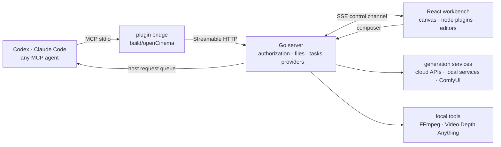

<p align="center">
  <picture>
    <source media="(prefers-color-scheme: dark)" srcset="assets/brand/logoDark.png">
    
  </picture>
</p>

<h3 align="center">Your agent. Your canvas. Your film.</h3>

<p align="center">
  A local-first AI video studio. One canvas connects storyboards, assets, 3D previs, generation and editing,<br>
  and every step you take by hand, your agent can continue with the same tools.
</p>

<p align="center">
  <a href="LICENSE"></a>
  
  
  
  
  
</p>

<p align="center">
  <strong>English</strong> ·
  <a href="readmeZh.md">中文</a> ·
  <a href="readmeJa.md">日本語</a>
</p>

<p align="center">
  <a href="https://opencinema.site">opencinema.site</a> ·
  <a href="#quick-start">Quick start</a> ·
  <a href="#features">Features</a> ·
  <a href="roadmap.md">Roadmap</a> ·
  <a href="#architecture">Architecture</a> ·
  <a href="#extend-opencinema">Extend</a> ·
  <a href="#contributing">Contribute</a> ·
  <a href="assets/promo/openCinemaLaunch.mp4">Launch film · 30 s</a>
</p>

<p align="center">
  
</p>
<p align="center"><sub>Real interface screenshot of a sample project. Generated results depend on the models, references and reviews you configure.</sub></p>

## Why OpenCinema

Generation tools answer how to produce a clip. OpenCinema answers how to finish a film.

- **Previs first, then generate, then fix only what needs fixing.** Block out movement and cameras in 3D, review each shot, and replace a single shot without redoing the film.
- **One canvas for the whole film.** Scripts, references, previs, generation, review and the edit plan are nodes on one canvas, and edges are reference relationships.
- **Your agent works on the same canvas.** Describe what you want in Codex, Claude Code or any MCP client. The agent reads and writes nodes through public MCP tools, and you can open an editor and change things by hand at any time. Both paths share one command path, one revision and one undo history.
- **Swap the generation backend.** Cloud models, local services and your existing ComfyUI workflows all plug into the same generation node.
- **Everything stays local.** The Go server listens on loopback only, a project is a plain folder on your disk, and credentials stay in local settings. Agents only ever see “configured” or “not configured”.

> **Status: 0.4.0, in development, unreleased.** Source builds work on macOS and Linux; Windows archives are not supported yet. The workbench interface is Chinese only for now, so button names below include an English gloss. AI generation uses the provider you configure and may cost money. See [Known limitations](#known-limitations).

## How it works



An agent first calls `getAppState` to pin the project and canvas, then discovers tools from their live schemas and executes them. Side-effecting calls carry an `operationId`, and canvas writes carry `expectedRevision`. Conflicts are rejected, and unknown results are looked up rather than blindly retried.

## Quick start

### 1. Requirements

| Tool | Version | Used for |
| --- | --- | --- |
| [Bun](https://bun.sh) | 1.3.14+ | Dependencies, web and plugin builds |
| [Go](https://go.dev/dl/) | 1.26+ | Compiling the local server |
| [Node.js](https://nodejs.org) | 22+ | Only for Claude Code and Codex integration. A full release package needs only this |
| FFmpeg | Optional | Audio and video processing. Download it from **Settings → FFmpeg** if you don't have it |
| Python | 3.10–3.12, optional | Only for the Video Depth node |

### 2. Build and run

```bash
git clone https://github.com/junjamrk/OpenCinema.git
cd OpenCinema
bun install --frozen-lockfile
bun run build
bun start
```

Open <http://127.0.0.1:47920>. The server listens on localhost only. Settings and credentials are stored in `data/` inside the repository, which Git ignores.

### 3. Open a project

Click **打开工程** (Open Project) and enter the absolute path of an existing folder, such as `/Users/me/Movies/myFilm`. An empty folder works too; the first canvas is created for you. After that, the home screen lists it under recent projects so you can get back in one click.

### 4. Choose how to generate

You can use both and switch per node at any time.

| | Configure a media provider | Connect an agent |
| --- | --- | --- |
| Best for | Calling models directly | Planning, building canvases, batch work |
| Requires | A provider API key or local service | Claude Code, Codex or another MCP client |
| Cost | Billed by the provider | Host subscriptions do not cover every video model |

**Configure a media provider**

1. Open **Settings → 媒体服务** (Media Services). The list shows which providers are configured.
2. Select a provider, enter the API key and save the connection.
3. On a generation node, click the parameters button and choose a model.

**Connect an agent**

<table>
<tr>
<td width="36%"></td>
<td valign="top">

Claude Code, from the root of the built repository:

```bash
claude --plugin-dir ./build/openCinema
```

Codex:

```bash
codex plugin marketplace add . --json
```

```bash
codex plugin add opencinema@openCinemaStandalone --json
```

Then ask the agent to connect to the OpenCinema workbench. In Claude Code you can use `/opencinema:opencinema`. Once the top right of the workbench shows it as connected, requests from the bottom input go to the agent.

Other MCP clients can copy a connection config from **Settings → 宿主 Agent** (Host Agent). See [Claude setup](docs/claudeSetup.md), in Chinese, for details.
</td>
</tr>
</table>

> Keep the workbench page open. Canvas and node tools run inside the page, and the agent operates the canvas through it.

### 5. Make your first shot

1. Drag an image onto the canvas.
2. Press `Tab` and choose **视频生成** (Video Generation).
3. Drag a connection from the right port of the image node to the left port of the generation node.
4. Select the generation node, click the parameters button above it, and pick a model, duration and aspect ratio.
5. Describe the shot in the bottom input and press `⌘/Ctrl + Enter`.

The node shows progress, and the finished video is saved to `assets/` in your project. From there you can capture frames, review the take, or connect it to the next node.

### A typical session

1. Open a project, drop in reference stills, a reference clip and an audio bed, and write a short brief.
2. Block the action and the camera in Blockout, export RGB and Depth for the shot, and freeze them as reference nodes.
3. Wire the brief, the still and the previs into a video generation node and set the reference roles.
4. Type the request into the composer, for example “make the chase feel faster”. The agent shows the generation plan first. Confirm it, then generate candidates.
5. Review each candidate. Rejected ones stay in the project.
6. In the edit plan, replace only the shot that failed, add the audio track and render a new cut.

### Troubleshooting

| Symptom | Fix |
| --- | --- |
| The send button is disabled | Read the hint under the input and use its connect-agent or configure-model button |
| No models to choose from | Configure a provider under **Settings → 媒体服务**, or add a custom one |
| Audio or video processing fails | Download FFmpeg under **Settings → FFmpeg**, or switch to the system install |
| Port 47920 is in use | Run `build/server/openCinema -listen 127.0.0.1:47921 -webRoot build/web -dataDirectory data` |
| The agent asks you to connect the workbench | Open the workbench page, enter the project, and ask the agent to read the state again |

## Features

### The canvas and 13 node plugins

<table>
<tr>
<td width="34%"></td>
<td valign="top">

Press <kbd>Tab</kbd> for the node palette, or drop files straight onto the canvas. Nodes connect by port type, and sources wired into a generation node appear as numbered references.

| Category | Nodes |
| --- | --- |
| Text and media | Text · Image · Video · Audio |
| Generation | Image · Video · Audio Generation |
| Space and camera | Blockout · 3D Director |
| Analysis | Video Analysis · Media Info · Motion · Video Depth |
| Workspace extension | Collaboration |

Multiple canvases, groups, alignment guides, grid snapping, auto-arrange, batch connect, undo and redo are built in and shared by agents and people. Shortcuts and the node menu are customizable in Settings.
</td>
</tr>
</table>

### You set the scope


Select one node and the composer acts on it alone. Marquee-select a group and the scope becomes those nodes. Select nothing and it is the whole canvas. Generation nodes can switch between generating and letting the agent adjust the node.

### Editors

<table>
<tr>
<td width="68%"></td>
<td valign="top"></td>
</tr>
</table>

Every operation creates a new copy or node and keeps the original.

- **Images**: inpainting with brush or box selection, markup, crop and transform, grid split, lighting, camera angle and panorama. Lighting and camera changes become generation drafts.
- **Video**: trim to a new node, capture first, last or current frame, extract audio, separate audio and video, change speed, video analysis, transcription, and entry points for review and the edit plan.
- **Audio**: waveform editing, segment joining, speed change and transcription. Processing runs through local FFmpeg.

### Blockout: see the shot before you generate


Place characters and set pieces on a white-model stage, block the action, record camera moves, and export RGB, Depth and Normal layers per shot plus a full animatic. Freezing an export turns it into reference nodes wired into video generation. The 3D Director node generates animation options from text for you to frame by hand.

Blockouts and relative depth are **references** for framing and motion rhythm. A plain video reference does not make a model reproduce motion exactly.

### Analysis

- **Video Analysis**: detects cut points and splits a clip into keyframes, shot segments and the audio track, with no Python or model API required.
- **Motion**: pose skeleton and 2D motion for clips up to 30 seconds, with optional relative depth and an exportable production pack. It is not a 3D camera solve.
- **Video Depth**: temporal relative depth from a locally prepared Video Depth Anything Small model. Builds never download models.
- **Media Info**: local codec, duration, frame rate and track inspection, with no upload.

### Generation plan, review and edit plan

- **See the plan first.** `getGenerationPlan` returns the final prompt, the actual model parameters and the role of every reference, without paying or submitting anything.
- **Review is a recorded human decision.** Six checks cover direction, action, identity, continuity, unexpected cuts and deformation. Rejected or unreviewed clips cannot enter a composition. The software never judges quality for you.
- **Replace one shot, keep the rest.** The edit plan stores 2–16 clips with order, in and out points, format and one audio track. Replacing a clip leaves the others untouched, and rendering creates a new output node.

See the [shot workflow](docs/videoShotWorkflow.md), in Chinese.

### Your models, your tools

<table>
<tr>
<td width="36%"></td>
<td valign="top">

Image, video and audio generation can each go through your host agent or a configured model.

| Provider | Image | Video | Audio |
| --- | --- | --- | --- |
| TF-router | ✓ | ✓ | ✓ |
| APIMart | ✓ | ✓ | |
| Compshare | ✓ | ✓ | |
| Metaso MiniMax H3 | | ✓ | |
| Volcengine Ark Seedance | | ✓ | |
| fal | ✓ | ✓ | ✓ |
| Replicate | ✓ | ✓ | ✓ |
| Local or LAN video service | | ✓ | |
| ComfyUI workflows | ✓ | ✓ | ✓ |
| Custom | ✓ | ✓ | ✓ |
</td>
</tr>
</table>

- **fal and Replicate presets**: Kling, FLUX and ElevenLabs on fal, Veo, FLUX and MiniMax Speech on Replicate. Add other models in Settings.
- **Jobs survive restarts**: after a disconnect or server restart, fal, Replicate, Ark, OpenAI-style, ComfyUI, `httpTask` and `adapter` jobs resume observing the original task instead of submitting a new paid request. Results are downloaded into the project and verified with FFprobe before they count as complete.
- **FFmpeg**: use a system install or a per-platform, SHA-pinned download. Commands run through filter and option allowlists.
- **Credentials** are entered only in the local settings panel. A configured credential does not mean the account is authenticated, billing is authorized or generation has been verified.

See the [provider docs](docs/videoProvider.md), in Chinese.

### ComfyUI workflows

ComfyUI does the generation and OpenCinema treats each workflow as a model, with no manifest to write:

1. Get the workflow running in ComfyUI, then choose **Export (API)**. The regular canvas save format cannot be imported.
2. Open **Settings → 媒体服务 → ComfyUI 工作流**, enable the connection, enter the address (`http://127.0.0.1:8188` by default) and click **保存并检测** (Save and Check).
3. Click **导入工作流** (Import Workflow), confirm which node receives the prompt, and mark each loader node as first frame, last frame, reference or keep as is.
4. Pick the workflow in a generation node. Agents use it through the same node tools.

Workflows run as black boxes. Only the inputs you confirmed are replaced, `seed` and `noise_seed` change on every submission, and output must go through a save node. At import you can add extra ratios and durations and tick fields to adjust on the node.

> Workflows run on ComfyUI, and custom nodes can execute arbitrary code. Only import workflows you trust. Agent tools cannot add or change workflows, so only you can import them in Settings.

### Collaboration and project management

- **Collaboration**: canvas collaboration on one server, with time-limited edit or read-only invites, per-user undo and reconnection. It does not start a public service or offer character-level co-editing.
- **Asset library**: global assets across projects that you can drag onto any canvas.
- **Project export**: download the project as an archive with canvases and assets.
- **Media history**: media nodes keep their generation history so you can switch back at any time.

## Architecture

| Layer | Where | Responsibility |
| --- | --- | --- |
| Go server | `apps/server` | Authorization and path boundaries, atomic file writes, the MCP endpoint and `operationId` records, media tasks and provider protocols, FFmpeg and the depth model, collaboration |
| React workbench | `apps/web` | The canvas (@xyflow/react), node views, editors, the tool catalog, the SSE control channel to Go |
| Editing session | `packages/workbenchCore` | Framework-independent document, revisions, undo and redo, and the save queue |
| Node SDK | `packages/nodeScaffold` · `packages/nodeShared` | Plugin contract, Zod tool registration, build output, cross-plugin business such as generation, review and the edit plan |
| Node plugins | `packages/nodes/*` | 13 built-in nodes, the collaboration extension and the Gaussian Splat market plugin |
| MCP bridge and plugin package | `packages/mcp` · `packages/openCinema` | stdio adapter, widget resource, launcher and leases, Codex and Claude manifests and skill |

Three invariants hold the design together: **one source of truth for schemas** (Zod → JSON Schema → Go → stdio), **one command path for people and agents** with shared revisions and undo, and **traceable side effects** (`operationId` idempotency, `unknown` is never retried automatically, outputs carry provenance and review records).

## Extend OpenCinema

### Write a node plugin

Most of OpenCinema is built from plugins, including all 13 built-in nodes. A plugin is an ESM module that runs in the workbench page, exchanges data through ports, and exposes capabilities as tools. Buttons and agents call the same tool, and agents discover it with no protocol changes.

Plugins can be developed outside this repository. The scaffold is not on npm yet, so pack it first from the repository root:

```bash
cd packages/nodeScaffold && npm pack
```

Generate a project where you keep your plugins, replacing `<repo>` with the real path:

```bash
npx --yes --package <repo>/packages/nodeScaffold/toonflow-nodes-scaffold-0.4.0.tgz createOpenCinemaPlugin helloNode --name "Word Count" --scaffold file:<repo>/packages/nodeScaffold/toonflow-nodes-scaffold-0.4.0.tgz
```

Install, check and build it:

```bash
cd helloNode && npm install && npm run typecheck && npm run build
```

Then open **Settings → 插件 → 安装插件包** (Plugins → Install package) and choose `dist/install.json`.

<details>
<summary>Example: a node that counts upstream text</summary>

Declare the plugin in the `openCinema` block of `package.json`. `getService` only returns services listed in `requires`:

```json
"openCinema": {
  "id": "helloNode",
  "name": "Word Count",
  "description": "Counts the characters of upstream text",
  "category": "Text and media",
  "requires": { "workbench": 1 }
}
```

`src/reactPlugin.ts`:

```ts
import { z } from "zod";
import type { NodePluginDefinition } from "@toonflow/nodes-scaffold/contracts";
import type { NodeWorkbenchService } from "@toonflow/nodes-scaffold/workbenchServices";
import { openCinema, version } from "../package.json";
import PluginView from "./reactView";

const plugin: NodePluginDefinition<typeof PluginView> = {
  ...openCinema, version, apiVersion: 1, renderer: "react", view: PluginView,
  createData: () => ({ label: openCinema.name, handles: [
    { id: "text", type: "target", dataType: "STRING", label: "Text" },
    { id: "count", type: "source", dataType: "STRING", label: "Count" },
  ], outputs: {} }),
  activate(context) {
    const workbench = context.getService<NodeWorkbenchService>("workbench");
    context.registerTool({
      name: "countText", description: "Counts the characters of upstream text and writes the result to the count output.",
      parameters: z.strictObject({}),
      outputSchema: z.strictObject({ count: z.number().int().nonnegative() }),
      annotations: { readOnlyHint: false, destructiveHint: false, idempotentHint: true, openWorldHint: false },
      async execute(_args, { signal }) {
        workbench.assertWritable();
        const text = workbench.getInputs("text").map(input => String(input.value ?? "")).join("");
        await workbench.updateData({ outputs: { count: { dataType: "STRING", value: String(text.length) } } }, undefined, signal);
        return { count: text.length };
      },
    });
  },
};

export default plugin;
```

`src/reactView.tsx`:

```tsx
import type { ReactNodeViewProps } from "@toonflow/nodes-scaffold/react";

export default function PluginView({ node, controller, readOnly }: ReactNodeViewProps) {
  const outputs = node.data?.outputs as { count?: { value?: string } } | undefined;
  return <div className="nodrag">
    <button type="button" disabled={readOnly} onClick={() => void controller.callNodeTool(node.id, "countText", {})}>Count</button>
    <span>{outputs?.count?.value ?? "Not counted yet"}</span>
  </div>;
}
```

After installing, **Word Count** appears in the node palette, and `getNodeTools` returns `node:countText` with its schema.
</details>

<details>
<summary>Plugin parts and where code belongs</summary>

| Part | Purpose |
| --- | --- |
| `createData` | Initial node data and ports. Port types include `STRING`, `IMAGE`, `VIDEO`, `AUDIO`, `FILE` |
| `view` | The React view |
| `registerTool` | Publishes a tool with Zod parameters |
| `composer` | Optional hook into the bottom input |
| `requires` | Required services and host capabilities such as `workbench`, `workspaceFiles` or `ffmpeg` |
| `category`, `description` | The node's group and summary in the node palette |
| `onDispose` | Releases workers, listeners and other resources |

Node-specific logic stays in its plugin package, logic shared by several plugins goes in `packages/nodeShared`, and generic contracts go in `packages/nodeScaffold`.

To ship a plugin as a built-in node, move it to `packages/nodes/<id>/`, import the build config from `@toonflow/nodes-scaffold/reactBuild`, set `outDir: "../../../build/nodes/<id>"`, add `order` to the `openCinema` block, add the workspace dependency to [`apps/web/package.json`](apps/web/package.json), and run `bun run generate:nodes`.
</details>

A plugin can also provide generation services by declaring `providers` in `viteConfig.ts`. They use the manifest format below and pass the same validation at install time.

> Installed plugins run in the page. `requires` only limits `getService` and is not a sandbox, so a plugin can still read and write the workspace. Only install packages you trust.

See the [node SDK](packages/nodeScaffold/readme.md), in Chinese, for the full contract.

To add a plugin inside this repository, run `bun packages/nodeScaffold/scripts/createNode.ts myNode "My node"`. It generates a skeleton that compiles and installs as-is, including an `agent.md` written for agents, which ships in the manifest and is read through `getPluginConfiguration`. Conventions are in the [plugin development guide](docs/pluginDevelopmentEn.md).

### Plugin market

[opencinema.site/market](https://opencinema.site/market/) is a static catalog. In **设置 → 插件 → 插件市场** (Settings → Plugins → Plugin market) the workbench downloads a package, verifies it against the SHA-256 in the index, shows a review card and only then installs it through the local server. Agents do the same with `getPluginMarket` → `installMarketplacePlugin`. The market is install-only for now. To publish, open a pull request that adds an entry to `site/src/marketCatalog.json`.

The first plugin in the market is [Gaussian Splat](packages/nodes/gaussianSplatNode/readme.md): view 3D Gaussian Splatting scans (PLY, SPLAT, KSPLAT, SPZ) on the canvas, set a camera, and render stills and turntable videos as references. It is not a built-in node. The whole three.js and GaussianSplats3D capability arrives through the plugin path, which shows that third-party and built-in nodes take the same route.

### Add a provider

If a service matches one of these protocols, a JSON manifest is all you need:

| Field | Service shape |
| --- | --- |
| `videoProtocol: "openaiVideo"` | Video jobs with multipart submit, poll by ID and content download; local or self-hosted |
| `videoProtocol: "fal"` | fal queue |
| `videoProtocol: "replicate"` | Replicate predictions |
| `videoProtocol: "httpTask"` | Any task-style HTTP service. Declare auth, submit, polling, state mapping and output paths in the manifest, with no code |
| `videoProtocol: "adapter"` | Your own local program that exchanges JSON over stdin and stdout, for flows such as request signing |
| `protocol: "openai"` | `images/generations` style image API |
| `endpoints.image`, etc. | Synchronous JSON API returning result URLs |

Open **Settings → 媒体服务** and add a custom provider. Start from a template, replace the address and model IDs, validate the manifest and add it, then enter the API key in the connection settings. Never put credentials in the manifest; the server rejects them.

<details>
<summary>Example manifest</summary>

```json
{
  "id": "remoteVideo",
  "label": "My Video Service",
  "apiUrl": "https://video.example.com/v1",
  "videoProtocol": "openaiVideo",
  "transport": "public",
  "cancelMode": "none",
  "endpoints": { "video": "videos" },
  "rules": [{ "field": "apiKey", "title": "API Key", "type": "input", "value": "", "props": { "type": "password" } }],
  "models": [{
    "id": "deployedModelName",
    "label": "Deployed video model",
    "type": "video",
    "mode": ["text", "endFrameOptional"],
    "imageRatios": ["16:9", "9:16"],
    "audio": false,
    "durationResolutionMap": [{ "duration": [4, 8], "resolution": ["720p"] }],
    "video": { "inputMap": { "firstFrame": "input_reference" } }
  }]
}
```
</details>

- For a local or LAN service, set `transport` to `"local"` and use an explicit IP and port. The API key is optional, and image, video and audio all work.
- Models can declare `parameters`, a subset of JSON Schema. Nodes generate a form from it, and agents read and write the same values.
- An `adapter` executable must be placed by hand in `providerAdapters/<provider id>/` under the data directory. A manifest cannot declare commands.

See the [provider docs](docs/videoProvider.md), in Chinese.

### The agent tool surface

| Tier | Discovery | Contents |
| --- | --- | --- |
| Core tools | `tools/list` | `getAppState`, `renderOpenCinema`, canvas read and write, `workspaceFiles`, `readWorkspaceImage`, `getOperation`, the host request queue |
| Workbench extensions | `getWorkbenchTools` → `workbenchTools` | Grouping, arranging, canvas management, asset library, provider and plugin management, FFmpeg and depth-model configuration |
| Node and workspace plugins | `getNodeTools` / `getWorkspaceTools` → `nodeTools` / `workspaceTools` | Shot plan, generation, review, edit plan, Blockout, motion analysis and other specialist functions |

Every tier has live schemas, output validation and `annotations`, and errors carry a machine code and a recovery action. Hosts that support MCP Apps can open the workbench inside the conversation with `renderOpenCinema`. See the [MCP SDK](packages/mcp/README.md) and the [plugin notes](packages/openCinema/readme.md), in Chinese.

### Release packages

`bun run release` archives an existing `build/openCinema` as `openCinema-<version>-<platform>-<arch>.zip` with checksums and a manifest. The unpacked folder needs only Node.js 22+ to load as a plugin. See the [release guide](docs/releaseGuide.md), in Chinese.

## Contributing

```bash
bun install --frozen-lockfile
```

```bash
bun run dev:web
```

```bash
bun run dev:server
```

Before opening a pull request:

```bash
bun run typecheck
```

```bash
bun run build
```

- **Read the [contributing guide](contributing.md) first**: new files and folders use lowerCamelCase, React component tags use PascalCase, canvas edits go through public commands or MCP tools, and file operations go through `@toonflow/file`.
- **Explain the change**: the problem, the final behavior, and the commands you actually ran. Include before and after screenshots for UI work, call and read-back results for agent capabilities, and real output specs for media tasks. Templates: [pull request](docs/pullRequestTemplate.md), [issue](docs/issueTemplate.md).
- **Do not commit** `build/`, `data/`, credentials, personal media or machine-specific absolute paths.
- **Do not add test files**: testing in this repository is handled separately. Use type checks, builds and manual verification.
- **New dependencies**: explain why they are needed and their license, keep the lockfile, and update the [third-party notices](thirdPartyNotices.md).
- **Welcome directions**: node and provider examples, English tool descriptions and interface strings, documentation and tutorials, performance on large canvases and media previews, Windows verification.

Security issues follow [security.md](security.md), and community interaction follows the [code of conduct](codeOfConduct.md). [Issues](https://github.com/junjamrk/OpenCinema/issues) · [Changelog](changelog.md)

## Launch film

[Watch the 30-second launch film](assets/promo/openCinemaLaunch.mp4). Every frame in it is drawn in code, and nothing was produced by a video model. The [storyboard](docs/launchVideoStoryboard.md) and the [source](assets/promo/launchVideo/readme.md) are in the repository. The earlier 58-second product concept film is at [assets/promo/openCinemaPromo.mp4](assets/promo/openCinemaPromo.mp4).

## Known limitations

- Node and canvas tools run inside the workbench page. With the page closed, agents can work with project files but cannot run nodes.
- Installed plugins are not sandboxed. `requires` only limits `getService`, and plugins still run in the page.
- ComfyUI progress reflects the current node, not the whole workflow. Uploaded references stay in its `input` folder because ComfyUI has no delete API. ComfyUI loses job records on restart. Such a job shows as unconfirmed and is never resubmitted automatically.
- Pricing and balance queries are available for TF-router only. Actual cost comes from the balance difference and shows as unknown when tasks on the same account overlap.
- Release archives must match your OS and CPU architecture. Hosts, providers and platforms are verified separately, so a passing build does not mean everything works.

## License and acknowledgements

[MIT](LICENSE), preserving the HBAI-Ltd copyright. Blockout and Motion are adapted from Sam Wasserman's tools of the same names (Apache-2.0). Fonts, icons, model weights, FFmpeg builds and user media keep their own terms, see the [third-party notices](thirdPartyNotices.md). The distribution and documentation approach references [Cowart](https://github.com/zhongerxin/Cowart).
