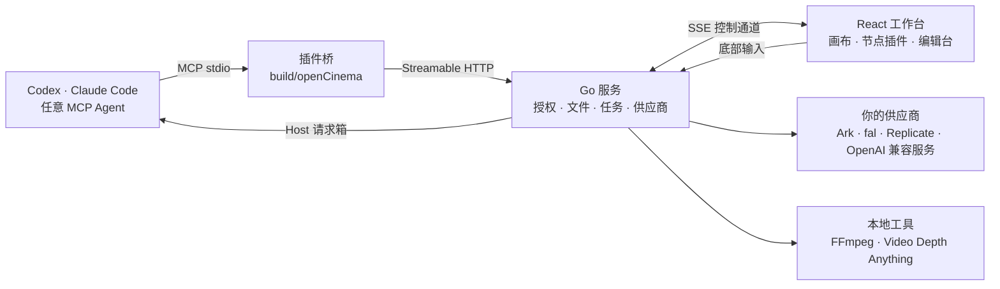

  <picture>
    <source media="(prefers-color-scheme: dark)" srcset="assets/brand/logoDark.png">
    
  </picture>

<h3 align="center">你的 Agent。你的画布。你的影片。</h3>

  本机运行的 AI 视频创作工作台。 
  Codex、Claude Code 或任何 MCP Agent 负责规划与对话，OpenCinema 提供节点画布、图像与视频工具、3D 预演、审片和最终剪辑。

  
  
  
  
  
  

  <a href="readmeEn.md">English</a> ·
  <a href="https://opencinema.site">opencinema.site</a> ·
  <a href="#快速开始">快速开始</a> ·
  <a href="#功能">功能</a> ·
  <a href="#架构">架构</a> ·
  <a href="#生态与扩展">扩展</a> ·
  <a href="#参与贡献">贡献</a> ·
  <a href="assets/promo/openCinemaLaunch.mp4">发布影片 · 30 秒</a>

  

真实界面截图，示例工程「Harbor Chase」。生成效果取决于你自己配置的模型、参考与审片。

## OpenCinema 是什么

- **一张画布贯穿全流程。** 分镜文本、参考素材、白模预演、图片与视频生成、审片、剪辑计划都是画布上的节点，连线就是参考关系。
- **Agent 操作同一张画布。** 你在 Codex、Claude Code 或任何 MCP 客户端里描述要求，Agent 通过公开的 MCP 工具读写节点；你随时打开编辑台手工修改，两条路径共用同一套命令、修订与撤销历史。
- **一切在本机。** Go 服务只监听回环地址，工程是你磁盘上的普通目录，模型凭据只保存在本机设置里，Agent 只能看到「已配置／未配置」。

> **当前状态：0.4.0 开发中，尚未发布。** macOS 与 Linux 可从源码构建；Windows 归档暂不支持。AI 生成使用你自己配置的供应商，可能计费；宿主订阅不包含任何视频模型。

## 工作方式

Agent 先调用 `getAppState` 固定工程与画布，再按实时 Schema 发现工具并执行；有副作用的调用带 `operationId`，写画布带 `expectedRevision`。完整契约见 [架构文档](docs/architecture.md)。

## 功能

### 画布与 13 个节点插件

<table>
<tr>
<td width="34%"></td>
<td valign="top">

按 <kbd>Tab</kbd> 打开节点面板，或直接把文件拖进画布。节点按端口类型（文本、图片、视频、音频、文件）连线，连进生成节点的素材会显示为带序号的参考。

| 分类 | 节点 |
| --- | --- |
| 文本与媒体 | 文本 · 图片 · 视频 · 音频 |
| 生成 | 图片生成 · 视频生成 · 音频生成 |
| 空间与摄影 | Blockout · 3D 导演 |
| 分析 | 视频分析（逐帧拉片） · 运动分析 · 视频深度 · 媒体信息 |
| 工作区扩展 | 多人协作 |

分组、整理、批量连线、撤销重做、历史记录和保存都是画布内建能力，Agent 与手工共用。
</td>
</tr>
</table>

### 你决定 Agent 的操作范围

选中一个节点，底部输入只作用于它；框选一组节点，范围变成「这 N 个节点」；什么都不选，就是整张画布。生成节点还能在「生成」和「让 Agent 调整节点」之间切换。普通 Web 的底部输入需要一个在线的宿主 Agent 来接收（见 [连接你的 Agent](#连接你的-agent)）。

### 素材编辑台

<table>
<tr>
<td width="68%"></td>
<td valign="top"></td>
</tr>
</table>

- **图片**：局部重绘与标记、裁剪与变换、宫格切分、打光、机位、全景。先画选区，再把创作要求交给底部输入，只改选中的区域。
- **视频**：截取片段、截首尾帧、提取音轨、分离音视频、变速、逐帧拉片、语音转文本，以及审阅视频与剪辑计划入口。
- **音频**：波形剪辑台与试听。所有处理通过本机 FFmpeg 完成，产物作为新节点进入画布，原素材保留。

### Blockout：先看清镜头，再生成

在白模舞台上摆放人物与物体、编排走位、录制相机运动，按镜头导出 RGB、Depth、Normal 层与整场 Animatic，并可「固定为本镜参考节点」接进视频生成。白模与深度是**参考**，用于构图和运动节奏；普通视频参考不保证模型逐像素复现运动。

### 分析

- **逐帧拉片**：检测镜头边界，拆成关键帧、分镜片段与音轨，按组落到画布。
- **运动分析**：姿态骨架与 2D 相机运动，可选相对深度，导出制作包。它不是 3D 相机解算。
- **视频深度**：用本机准备的 Video Depth Anything Small 生成时序相对深度，作为控制类参考使用。

### 生成计划、审片与剪辑计划

- **生成前看计划。** `getGenerationPlan` 返回最终提示词、实际模型参数、每条参考的职责（`instruction` / `identity` / `composition` / `motion` / `exclude`）与请求槽位，不付费、不提交。
- **审片是人的记录。** 方向、动作、身份、空间连续、意外切镜、形变与品牌六项逐一标记；全部通过并写下观察才可 `approved`，`rejected` 保留原片。软件不替你判断质量。
- **只换有问题的镜头。** 剪辑计划保存 2–16 镜的顺序、入出点、规格与一条音轨；按修订整体保存，局部替换一镜时其余镜头原样保留，渲染生成新成片节点，旧成片不动。

### 你的模型，你的工具

<table>
<tr>
<td width="36%"></td>
<td valign="top">

- **视频供应商**：火山方舟 Seedance、fal、Replicate、本地或局域网的 OpenAI 兼容视频服务，以及若干中转服务；也可用 JSON manifest 导入自定义供应商。
- **FFmpeg**：使用系统安装或按平台 SHA 校验下载；执行命令经过过滤器与参数白名单。
- **深度模型**：显式准备 Python 运行环境与权重，按 commit 与 SHA 固定，不会在构建时偷偷下载。
- 凭据只在本机设置面板录入；配置了凭据不代表已鉴权、已授权计费或生成已验收。

详见 [视频供应商](docs/videoProvider.md) 与 [镜头工作流](docs/videoShotWorkflow.md)。
</td>
</tr>
</table>

## 快速开始

### 环境要求

| 用途 | 需要 |
| --- | --- |
| 从源码构建 | Bun 1.3.14+、Go 1.26+、Node.js 22+ |
| 运行完整发行包 | 仅 Node.js 22+ |
| 本地媒体处理 | FFmpeg / FFprobe（可在设置中下载） |
| 视频深度（可选） | Python 3.10–3.12 |

### 从源码运行

~~~sh
git clone https://github.com/junjamrk/OpenCinema.git
cd OpenCinema
bun install --frozen-lockfile
bun run build
bun start
~~~

打开 [http://127.0.0.1:47920](http://127.0.0.1:47920)，点击「打开工程」，输入任意目录的绝对路径。把图片、视频、音频拖进画布即可创建节点；工程目录下会保存 `画布1.json` 与 `assets/`。

### 连接你的 Agent

<table>
<tr>
<td width="36%"></td>
<td valign="top">

**Claude Code**（在已构建的仓库中）：

~~~sh
claude --plugin-dir ./build/openCinema
~~~

或安装为当前工程的插件：

~~~sh
claude plugin marketplace add ./ --scope local
claude plugin install opencinema@openCinemaStandalone --scope local
~~~

调用 `/opencinema:opencinema`，Agent 会先读取 `getAppState`，再打开你的工程。

**Codex**：

~~~sh
codex plugin marketplace add . --json
codex plugin add opencinema@openCinemaStandalone --json
~~~

支持 MCP Apps 的宿主可用 `renderOpenCinema` 在对话中直接打开工作台。

**其他 MCP 客户端**：在设置面板「宿主 Agent」中复制 MCP 连接配置；连接名为 `openCinemaStudio`。
</td>
</tr>
</table>

普通 Web 页面的底部输入需要一个在线宿主：Agent 调用 `registerHost` 声明创作能力，按租约轮询 `pollHostRequests` 领取指令，再通过画布工具执行并用 `completeHostRequest` 回报。详细步骤见 [Claude 接入](docs/claudeSetup.md)。

### 一次典型的创作

1. 打开工程，拖入参考图、参考片段与音频，写一段分镜文本。
2. 在 Blockout 里摆走位和相机，导出本镜 RGB／Depth，固定为参考节点。
3. 把文本、参考图、白模接进视频生成节点，设置参考职责。
4. 在底部输入写下要求，例如「让追车更快」，Agent 先给出生成计划，确认后再生成候选。
5. 逐项审片，拒绝的候选保留在工程里。
6. 在剪辑计划中只替换有问题的镜头，加入音轨，渲染新成片。

## 架构

| 层 | 位置 | 职责 |
| --- | --- | --- |
| Go 服务 | `apps/server` | 授权与路径边界、原子文件写入、MCP 入口与 `operationId` 记录、媒体任务与供应商协议、FFmpeg 与深度模型、协作 |
| React 工作台 | `apps/web` | 画布（@xyflow/react）、节点视图、编辑台、工具目录、与 Go 的 SSE 控制通道 |
| 编辑会话 | `packages/workbenchCore` | 框架无关的文档、修订、撤销重做与保存队列 |
| 节点 SDK | `packages/nodeScaffold` · `packages/nodeShared` | 插件合同、Zod 工具发布、构建产物、跨插件业务（生成、审片、剪辑计划） |
| 节点插件 | `packages/nodes/*` | 14 个内置节点与扩展 |
| MCP 桥与插件包 | `packages/mcp` · `packages/openCinema` | stdio 适配器、Widget 资源、启动器与租约、Codex／Claude 清单与 Skill |

设计上有三个不变量：**Schema 只有一个来源**（Zod → JSON Schema → Go → stdio）；**手工与 Agent 走同一条命令路径**，共享修订与撤销；**副作用可追溯**（`operationId` 幂等、`unknown` 不自动重试、生成产物带来源与审片记录）。完整说明与工程评估见 [docs/architecture.md](docs/architecture.md)。

## 生态与扩展

### 写一个节点

节点是一个独立包，导出 `NodePluginDefinition`，用 Zod 声明工具，UI 和 Agent 调同一个实现：

~~~ts
// packages/nodes/myNode/src/reactPlugin.ts
import { z } from "zod";
import type { NodePluginDefinition } from "@toonflow/nodes-scaffold";
import { MyNodeView } from "./reactView";

const plugin: NodePluginDefinition = {
  apiVersion: 1, id: "myNode", name: "我的节点", version: "1.0.0", renderer: "react",
  view: MyNodeView,
  createData: () => ({ handles: [{ type: "target", id: "in", dataType: "IMAGE" }, { type: "source", id: "out", dataType: "IMAGE" }] }),
  activate(ctx) {
    ctx.registerTool({
      name: "describe", description: "读取当前输入并返回摘要",
      parameters: z.object({ detail: z.enum(["short", "full"]).default("short") }),
      annotations: { readOnlyHint: true },
      execute: async ({ detail }) => ({ summary: await summarise(ctx, detail) }),
    });
  },
};
export default plugin;
~~~

`vite.config.ts` 里一行 `createNodeConfig({ name: "myNode", displayName: "我的节点", author, github }, import.meta.url)`，`bun run build` 输出 `build/nodes/myNode/install.json`（带 SHA-256 的清单、ESM 与资源）。在设置面板「插件」里安装，或由 Agent 调用 `reviewPluginPackage` → `installPluginPackage`。完整合同见 [节点 SDK](packages/nodeScaffold/readme.md)。

### 接入一个供应商

说同一种协议（`openaiVideo` / `fal` / `replicate` / `ark`）的服务只需一个 JSON manifest，无需改代码：

~~~json
{
  "id": "remoteVideo",
  "label": "自建视频服务",
  "apiUrl": "https://video.example.com/v1",
  "videoProtocol": "openaiVideo",
  "transport": "public",
  "rules": [{ "field": "apiKey", "title": "API Key", "type": "input", "props": { "type": "password" } }],
  "models": [{ "id": "deployedModel", "label": "已部署模型", "type": "video", "mode": ["text", "endFrameOptional"],
               "durationResolutionMap": [{ "duration": [4, 8], "resolution": ["720p"] }],
               "video": { "inputMap": { "firstFrame": "input_reference" } } }]
}
~~~

未声明映射的参考会被明确拒绝而不是静默丢弃；密钥只存服务端。见 [视频供应商](docs/videoProvider.md)。

### Agent 工具面

| 层 | 发现方式 | 内容 |
| --- | --- | --- |
| 核心工具 | `tools/list` | `getAppState`、`renderOpenCinema`、画布读写、`workspaceFiles`、`readWorkspaceImage`、`getOperation`、Host 请求箱 |
| 工作台扩展 | `getWorkbenchTools` → `workbenchTools` | 分组、整理、画布管理、素材库、供应商与插件管理、FFmpeg 与深度模型配置 |
| 节点与工作区插件 | `getNodeTools` / `getWorkspaceTools` → `nodeTools` / `workspaceTools` | 镜头计划、生成、审片、剪辑计划、Blockout、运动分析等专业函数 |

每层都有实时 Schema、输出校验与 `annotations`；错误带机器码与恢复动作。见 [MCP SDK](packages/mcp/README.md) 与 [插件说明](packages/openCinema/readme.md)。

### 发行包

`bun run release` 把已构建的 `build/openCinema` 归档为 `openCinema-<version>-<platform>-<arch>.zip`，附校验和与清单；解压后只需 Node.js 22+ 即可作为插件加载。见 [发行指南](docs/releaseGuide.md)。

## 参与贡献

~~~sh
bun install --frozen-lockfile
bun run dev:web        # Vite 开发服务器
bun run dev:server     # go run，监听 127.0.0.1:47920
bun run typecheck      # Web、内核、MCP、插件与 go vet
bun run build          # 全量构建
~~~

- 先读 [贡献指南](contributing.md)：命名用小驼峰（组件 PascalCase）、画布编辑走公开命令或 MCP 工具、文件操作复用 `@toonflow/file`，不绕过公开包导出。
- 提 PR 请说明问题、最终行为、涉及的入口与边界，并附实际执行的命令与证据：UI 改动附前后截图，Agent 能力附发现、调用、保存与回读结果，媒体任务附真实产物规格。模板见 [PR 模板](docs/pullRequestTemplate.md)、[问题模板](docs/issueTemplate.md)。
- 欢迎的方向：节点与供应商示例、英文化的工具描述与界面字符串、文档与教程、性能（大画布与媒体预览）、Windows 支持验证。
- 安全问题按 [security.md](security.md) 处理；社区交流遵守 [行为准则](codeOfConduct.md)。[提交问题](https://github.com/junjamrk/OpenCinema/issues) · [变更记录](changelog.md)

## 发布影片

[观看 30 秒发布影片](assets/promo/openCinemaLaunch.mp4)。影片中的界面与画面全部由代码绘制，不含任何模型生成镜头；[分镜脚本](docs/launchVideoStoryboard.md)与[源码](assets/promo/launchVideo/readme.md)在仓库中。更早的 58 秒产品概念片见 [assets/promo/openCinemaPromo.mp4](assets/promo/openCinemaPromo.mp4)。

## 许可与致谢

[MIT](LICENSE)，保留 HBAI-Ltd 原版权。Blockout 与 Motion 改编自 Sam Wasserman 的同名工具（Apache-2.0）；字体、图标、模型权重、FFmpeg 构建及用户素材遵循各自条款，详见 [第三方声明](thirdPartyNotices.md)。插件分发与文档结构参考 [Cowart](https://github.com/zhongerxin/Cowart)。
