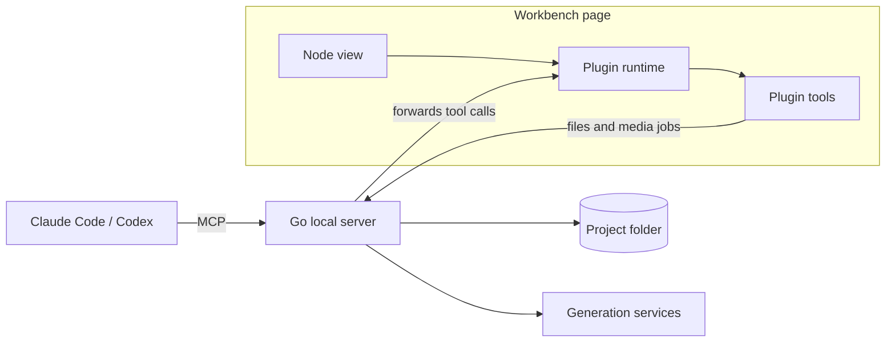

<p align="center">
  <picture>
    <source media="(prefers-color-scheme: dark)" srcset="assets/brand/logoDark.png">
    
  </picture>
</p>

<h3 align="center">From idea to final cut, directed with your Agent.</h3>

<p align="center">
  A local-first AI video studio. One canvas connects storyboards, assets, 3D previs, generation and editing,<br>
  and every step you take by hand, your Agent can continue with the same tools.
</p>

<p align="center">
  <a href="#quick-start">Quick Start</a> ·
  <a href="#features">Features</a> ·
  <a href="#building-plugins-and-contributing">Build a Plugin</a> ·
  <a href="docs/claudeSetup.md">Claude Setup</a> ·
  <a href="readme.md">中文</a> ·
  <a href="LICENSE">MIT</a>
</p>

<p align="center">
  <a href="assets/promo/openCinemaPromo.mp4">
    
  </a>
</p>

<p align="center"><sub>Product motion design. Actual output depends on the chosen model, references and your review.</sub></p>

## Why OpenCinema

Generation tools answer how to produce a clip. OpenCinema answers how to finish a film.

- **Previs first, then generate, then fix only what needs fixing.** Block out movement and cameras in 3D, review each shot, and replace a single shot without redoing the film.
- **From storyboard to final cut on one canvas.** Shot plans, candidate review and edit plans connect, so every shot moves through the same process.
- **Swap the generation backend.** Cloud models, local services and your existing ComfyUI workflows all plug into the same generation node.

A project is an ordinary folder on disk, you and your Agent share one toolset, and credentials stay on your machine.

Current version: **0.4.0, in development**, with no stable release yet. See [Known Limitations](#known-limitations).

## Quick Start

### 1. Prerequisites

| Tool | Version | Used for |
| --- | --- | --- |
| [Bun](https://bun.sh) | 1.3.14+ | Dependencies, web and plugin builds |
| [Go](https://go.dev/dl/) | 1.26+ | Compiling the local server |
| [Node.js](https://nodejs.org) | 22+ | Only for Claude Code / Codex integration |
| FFmpeg | Optional | Audio and video processing. Download it from **Settings → FFmpeg** if you don't have it |

### 2. Build and run

```bash
git clone https://github.com/junjamrk/OpenCinema.git
cd OpenCinema
bun install --frozen-lockfile
bun run build
bun start
```

Open <http://127.0.0.1:47920>. The server listens on localhost only. Settings and credentials are stored in `data/` inside the repository, which Git ignores.

### 3. Open a project

Click **打开工程** (Open Project) and enter the absolute path of an existing folder, such as `/Users/me/Movies/myFilm`. An empty folder works too; the first canvas is created for you. After that, the home screen lists it under recent projects so you can get back in one click.

### 4. Choose how to generate

You can use both and switch per node at any time.

| | Configure a media provider | Connect an Agent |
| --- | --- | --- |
| Best for | Calling models directly | Planning, building canvases, batch work |
| Requires | A provider API key or local service | Claude Code or Codex |
| Cost | Billed by the provider | Host subscriptions do not cover every video model |

**Configure a media provider**

1. Open **Settings → 媒体服务** (Media Services). The list shows which providers are configured.
2. Select a provider, enter the API key and save the connection.
3. On a generation node, click the parameters button and choose a model.

**Connect an Agent**

From the root of the built repository, run:

```bash
claude --plugin-dir ./build/openCinema
```

For Codex:

```bash
codex plugin marketplace add . --json
```

```bash
codex plugin add opencinema@openCinemaStandalone --json
```

Then ask the Agent to connect to the OpenCinema workbench (in Claude Code you can use `/opencinema:opencinema`). Once the top right of the workbench shows it as connected, requests from the bottom input go to the Agent. Other MCP hosts can copy a connection config from **Settings → 宿主 Agent** (Host Agent). See [Claude Setup](docs/claudeSetup.md) for details.

> Keep the workbench page open. Canvas and node tools run inside the page, and the Agent operates the canvas through it.

### 5. Make your first shot

1. Drag an image onto the canvas.
2. Press `Tab` and choose **视频生成** (Video Generation).
3. Drag a connection from the right port of the image node to the left port of the generation node.
4. Select the generation node, click the parameters button above it, and pick a model, duration and aspect ratio.
5. Describe the shot in the bottom input and press `⌘/Ctrl + Enter`.

The node shows progress, and the finished video is saved to `assets/` in your project. From there you can capture frames, review the take, or connect it to the next node.

### Troubleshooting

| Symptom | Fix |
| --- | --- |
| The send button is disabled | Read the hint under the input and use its connect-Agent or configure-model button |
| No models to choose from | Configure a provider under **Settings → 媒体服务**, or add a custom one |
| Audio or video processing fails | Download FFmpeg under **Settings → FFmpeg**, or switch to the system install |
| Port 47920 is in use | Run `build/server/openCinema -listen 127.0.0.1:47921 -webRoot build/web -dataDirectory data` |
| The Agent asks you to connect the workbench | Open the workbench page, enter the project, and ask the Agent to read the state again |

## Features

### Nodes

| Node | What it does |
| --- | --- |
| **Text** | Markdown scripts and notes, with rich-text and source editing |
| **Image** | Inpainting, crop, grid split, relighting, camera angles, panorama |
| **Video** | Frame capture, trim, speed change, audio extraction, separation, review, transcription |
| **Audio** | Waveform editing, segment joining, speed change, transcription |
| **Image Generation** | Prompt plus references; also receives inpaint, lighting and camera drafts |
| **Video Generation** | Text, single image, first/last frame and multimodal references, with shot plans and take review |
| **Audio Generation** | Voice and sound from text or reference media |
| **Blockout** | 3D scenes, staging and cameras, exporting RGB/Depth references and animatics |
| **3D Director** | Generate scenes, action and camera moves from text, then frame by hand and export |
| **Video Analysis** | Local cut detection with keyframes, shot clips and audio |
| **Media Info** | Local codec, duration, frame rate and track inspection, with no upload |
| **Motion** | 2D motion, pose and relative depth analysis, exporting a production pack |
| **Video Depth** | Local model that turns a video into a depth reference |

A workspace extension adds [multiplayer collaboration](#collaboration-and-project-management).

### Canvas

- Multiple canvases, canvas folders, node groups and merging, with live save status.
- Drop files or paste content to create nodes. Dragging a port into empty space lists only compatible node types.
- Arrange or connect a selection in bulk, or drag it into empty space to create and connect a new node.
- Alignment guides, grid snapping, minimap, auto-arrange and edge highlighting.
- Project undo and redo, and `Alt`-drag to duplicate.
- Shortcuts and the node menu are customizable in Settings.

Common shortcuts: `Tab` add node, `⌘/Ctrl + F` search nodes, `V` select, `H` hand tool, hold `Space` to pan, `⌘/Ctrl + G` group, `Alt + Shift + F` arrange.

### Image editing

Select an image node and click the brush button in its toolbar. Every operation creates a new copy and keeps the original.

- **Inpainting**: paint or box-select a region and describe the change. Only that region is replaced.
- **Markup**: brush, rectangle, ellipse, text and eraser, savable as an annotated copy.
- **Crop and transform**: locked aspect ratios, exact pixel values, rotation and flips.
- **Grid split**: cut a storyboard sheet into separate images, grouped automatically.
- **Lighting and camera**: adjust lights or the camera in a 3D stage and turn the result into a generation draft.
- **Panorama**: spherical or cylindrical projection, capturing 1, 4 or 12 views with lens, perspective and seam correction.

The editor supports zoom (`⌘/Ctrl + wheel`, `+`, `-`, `0`), tool shortcuts (`B` brush, `R` rectangle, `C` ellipse, `T` text, `E` eraser, `[` `]` brush size) and its own undo history.

### Generation and providers

Image, video and audio generation can each go through your host Agent or a configured model.

| Provider | Image | Video | Audio | Notes |
| --- | --- | --- | --- | --- |
| TF-router | ✓ | ✓ | ✓ | Pricing and balance queries |
| APIMart | ✓ | ✓ | | |
| Compshare | ✓ | ✓ | | |
| Metaso MiniMax H3 | | ✓ | | |
| Volcengine Ark Seedance | | ✓ | | Multimodal image and video references |
| fal | | ✓ | | Add more models on the same protocol in Settings |
| Replicate | | ✓ | | Add more models on the same protocol in Settings |
| Local / LAN video service | | ✓ | | Connects to an OpenAI-style service on your machine or network |
| ComfyUI workflows | ✓ | ✓ | ✓ | ComfyUI on your machine or network. Import a workflow and use it as a model, see [Use ComfyUI workflows](#use-comfyui-workflows) |
| Custom | ✓ | ✓ | ✓ | JSON manifest, see [Adding a provider](#adding-a-provider) |

Generation jobs are persisted. After a disconnect or server restart, fal, Replicate, Ark, OpenAI-style and ComfyUI jobs resume observation of the original task instead of submitting a new paid request. Results are downloaded into the project and verified with FFprobe before they count as complete. See the [video provider docs](docs/videoProvider.md).

### Previs and shot analysis

- **Blockout**: scenes, entities, takes and cameras, with paths, action presets and local GLB/glTF import. Pin RGB/Depth as reference nodes for generation.
- **3D Director**: the host Agent generates animation options from text, then you frame shots and record keyframes.
- **Video Analysis**: frame-accurate cut detection with no Python or model API required.
- **Motion**: motion and pose analysis of clips up to 30 seconds, exporting OpenPose, Depth, Edges and other layers.
- **Video Depth**: local Video Depth Anything Small inference. It needs Python 3.10–3.12 and explicit preparation under **Settings → 媒体服务**. The build never downloads models.

Blockouts and relative depth are previs references. A plain video reference does not guarantee that a model reproduces the motion exactly.

### Shots, review and final cut

A finished generation is only a candidate. Review decides whether it is used.

1. **Shot plan**: record action, direction and camera movement, assign a role to each reference, and inspect the real prompt and parameters before generating.
2. **Take review**: mark usable ranges and check direction, action, identity, spatial continuity, unintended cuts and deformation.
3. **Edit plan**: keep shot order, in and out points, format and audio, for 2–16 shots with one external audio track.
4. **Shot replacement**: swap one shot, preflight the whole film, and render a new cut. Rejected or unreviewed clips cannot enter a composition.

See the [shot workflow](docs/videoShotWorkflow.md).

### Agent and MCP

- More than 50 workbench tools over standard MCP. Node tools are discovered live from the current canvas, so tools added by a plugin reach Agents with no protocol changes.
- Your selection is the Agent's scope. With nothing selected, it works on the whole canvas.
- Writes are bound to a revision and an `operationId`. Conflicts are rejected, and unknown results are looked up rather than blindly retried.
- File tools work without the workbench page. Canvas writes must go through tools, never by editing JSON directly.
- Hosts that support MCP Apps can render the workbench as a native widget.

See the [MCP SDK](packages/mcp/README.md) for the protocol and data model.

### Collaboration and project management

- **Collaboration**: canvas collaboration on one server, with time-limited edit or read-only invites, per-user undo and reconnection. It does not start a public service or offer character-level co-editing.
- **Asset library**: global assets across projects that you can drag onto any canvas.
- **Project export**: download the project as an archive with canvases and assets.
- **Media history**: media nodes keep their generation history so you can switch back at any time.

## Building Plugins and Contributing

### The plugin system

Most of OpenCinema is built from plugins, including all 13 built-in nodes and the collaboration extension. A plugin is an ESM module that runs in the workbench page, exchanges data through ports, and exposes capabilities to users and Agents as tools.



A plugin is made of:

| Part | Purpose |
| --- | --- |
| `createData` | Initial node data and ports. Port types include `STRING`, `IMAGE`, `VIDEO`, `AUDIO`, `FILE` |
| `view` | The React view |
| `registerTool` | Publishes a tool with Zod parameters. Buttons and Agents call the same tool |
| `composer` | Optional hook into the bottom input |
| `requires` | Required services and host capabilities such as `workbench`, `workspaceFiles` or `ffmpeg`. `getService` only returns declared services |
| `category`, `description` | The node's group and summary in the add-node palette |
| `onDispose` | Releases workers, listeners and other resources |

Where code belongs: node-specific logic stays in its plugin package, logic shared by several plugins goes in `packages/nodeShared`, and generic contracts go in `packages/nodeScaffold`.

### Write a node plugin

Plugins can be developed outside this repository. This example counts the characters of upstream text, and the code below has passed type checking and a build. The scaffold is not on npm yet, so pack it from this repository first.

**1. Pack the scaffold**

Run this from the repository root. It produces `packages/nodeScaffold/toonflow-nodes-scaffold-0.4.0.tgz`:

```bash
cd packages/nodeScaffold && npm pack
```

**2. Generate a plugin project**

Run this where you keep your plugins, replacing `<repo>` with the real path:

```bash
npx --yes --package <repo>/packages/nodeScaffold/toonflow-nodes-scaffold-0.4.0.tgz createOpenCinemaPlugin helloNode --name "Word Count" --scaffold file:<repo>/packages/nodeScaffold/toonflow-nodes-scaffold-0.4.0.tgz
```

```bash
cd helloNode && npm install
```

**3. Declare the plugin in `package.json`**

The name, category, description and permissions live in the `openCinema` block. `getService` only returns services declared in `requires`:

```json
"openCinema": {
  "id": "helloNode",
  "name": "Word Count",
  "description": "Counts the characters of upstream text",
  "category": "Text and media",
  "requires": { "workbench": 1 }
}
```

**4. `src/reactPlugin.ts`**

```ts
import { z } from "zod";
import type { NodePluginDefinition } from "@toonflow/nodes-scaffold/contracts";
import type { NodeWorkbenchService } from "@toonflow/nodes-scaffold/workbenchServices";
import { openCinema, version } from "../package.json";
import PluginView from "./reactView";

const plugin: NodePluginDefinition<typeof PluginView> = {
  ...openCinema, version, apiVersion: 1, renderer: "react", view: PluginView,
  createData: () => ({ label: openCinema.name, handles: [
    { id: "text", type: "target", dataType: "STRING", label: "Text" },
    { id: "count", type: "source", dataType: "STRING", label: "Count" },
  ], outputs: {} }),
  activate(context) {
    const workbench = context.getService<NodeWorkbenchService>("workbench");
    context.registerTool({
      name: "countText", description: "Counts the characters of upstream text and writes the result to the count output.",
      parameters: z.strictObject({}),
      outputSchema: z.strictObject({ count: z.number().int().nonnegative() }),
      annotations: { readOnlyHint: false, destructiveHint: false, idempotentHint: true, openWorldHint: false },
      async execute(_args, { signal }) {
        workbench.assertWritable();
        const text = workbench.getInputs("text").map(input => String(input.value ?? "")).join("");
        await workbench.updateData({ outputs: { count: { dataType: "STRING", value: String(text.length) } } }, undefined, signal);
        return { count: text.length };
      },
    });
  },
};

export default plugin;
```

**5. `src/reactView.tsx`**

```tsx
import type { ReactNodeViewProps } from "@toonflow/nodes-scaffold/react";

export default function PluginView({ node, controller, readOnly }: ReactNodeViewProps) {
  const outputs = node.data?.outputs as { count?: { value?: string } } | undefined;
  return <div className="nodrag">
    <button type="button" disabled={readOnly} onClick={() => void controller.callNodeTool(node.id, "countText", {})}>Count</button>
    <span>{outputs?.count?.value ?? "Not counted yet"}</span>
  </div>;
}
```

**6. Build**

```bash
npm run typecheck
```

```bash
npm run build
```

The output is in `dist/`, and `install.json` is the package you can share.

**7. Install and use**

Open **Settings → 插件 → 安装插件包** (Plugins → Install package), choose `install.json` and confirm. **Word Count** now appears in the add-node palette. Connect a text node to its input and click **Count**.

Agents discover the tool with no extra setup: `getNodeTools` returns `node:countText` with its schema.

**Provide a generation service from a plugin**

Declare `providers` in `viteConfig.ts`. The format matches the JSON manifest in [Adding a provider](#adding-a-provider) and passes the same validation at install time. The provider appears in the media service list while the plugin is enabled and disappears when it is disabled or uninstalled. Its ID must not clash with a built-in or user-added provider:

```ts
export default createNodeConfig({
  author: "", github: "",
  providers: [{ id: "myVideo", label: "My Video", apiUrl: "https://video.example.com/v1", videoProtocol: "openaiVideo", endpoints: { video: "videos" }, rules: [], models: [] }],
}, import.meta.url);
```

> Installed plugins run in the page. `requires` only limits `getService` and is not a sandbox, so a plugin can still read and write the workspace. Only install packages you trust.

See the [node SDK](packages/nodeScaffold/readme.md) for the full plugin contract, resource bundling and host capabilities.

### Use ComfyUI workflows

ComfyUI does the generation and OpenCinema treats each workflow as a model. Image, video and audio workflows all work, with no manifest to write:

1. Get the workflow running in ComfyUI, then choose **Export (API)** to get a JSON file. The regular canvas save format cannot be imported.
2. Open **Settings → 媒体服务 → ComfyUI 工作流**, enable the connection, enter the address (`http://127.0.0.1:8188` by default) and click **保存并检测**.
3. Click **导入工作流**, confirm which node receives the prompt, and mark each loader node as first frame, last frame, reference or keep as is.
4. Pick the workflow in a generation node. Agents use it through the same node tools.

Workflows run as black boxes:

- Only the inputs you confirmed are replaced. Models, samplers and other parameters keep their workflow values.
- The prompt must be mapped. The number of connected references must match the mapped nodes, or nothing is submitted.
- `seed` and `noise_seed` change on every submission. Otherwise ComfyUI returns its cached result.
- An imported workflow offers only its original size and duration. To add choices, edit `imageRatios` and `durationResolutionMap` in the model's advanced declaration.
- The workflow must output through a save node. Temporary files from preview nodes are not collected. Supported outputs are mp4 and webm for video, png, jpg and webp for images, and flac, wav and mp3 for audio.

> Workflows run on ComfyUI, and custom nodes can execute arbitrary code. Only import workflows you trust.

See the [video provider docs](docs/videoProvider.md#comfyui-工作流) for the full model format.

### Adding a provider

If a service matches one of these protocols, a JSON manifest is all you need:

| Field | Service shape |
| --- | --- |
| `videoProtocol: "openaiVideo"` | Video jobs with multipart submit, poll by ID and content download; local or self-hosted |
| `videoProtocol: "fal"` | fal queue |
| `videoProtocol: "replicate"` | Replicate predictions |
| `protocol: "openai"` | `images/generations` style image API |
| `endpoints.image`, etc. | Synchronous JSON API returning result URLs |

Open **Settings → 媒体服务** and add a custom provider. Start from the video or image template, replace the address and model IDs, validate the manifest and add it, then enter the API key in the connection settings. Never put credentials in the manifest; the server rejects them.

```json
{
  "id": "remoteVideo",
  "label": "My Video Service",
  "apiUrl": "https://video.example.com/v1",
  "videoProtocol": "openaiVideo",
  "transport": "public",
  "cancelMode": "none",
  "endpoints": { "video": "videos" },
  "rules": [{ "field": "apiKey", "title": "API Key", "type": "input", "value": "", "props": { "type": "password" } }],
  "models": [{
    "id": "deployedModelName",
    "label": "Deployed video model",
    "type": "video",
    "mode": ["text", "endFrameOptional"],
    "imageRatios": ["16:9", "9:16"],
    "audio": false,
    "durationResolutionMap": [{ "duration": [4, 8], "resolution": ["720p"] }],
    "video": { "inputMap": { "firstFrame": "input_reference" } }
  }]
}
```

For a local or LAN service, set `transport` to `"local"` and use an explicit IP and port.

If a service does not fit, for example because of a different auth scheme or job API, add a protocol adapter in [`apps/server/go/videoProvider.go`](apps/server/go/videoProvider.go) and open a pull request.

### Making a plugin built-in

A plugin package can be shared and installed directly. To ship it as a built-in node:

1. Move the project to `packages/nodes/<id>/`, import the build config from `@toonflow/nodes-scaffold/reactBuild`, and set `outDir: "../../../build/nodes/<id>"`.
2. Add `order` to the `openCinema` block in `package.json` to set its place in the menu.
3. Add the workspace dependency to [`apps/web/package.json`](apps/web/package.json).
4. Run `bun run generate:nodes` to regenerate the built-in catalog, and commit the result.

### Submitting code

Run the web app and Go server separately in development:

```bash
bun run dev:web
```

```bash
bun run dev:server
```

Before opening a pull request:

```bash
bun run typecheck
```

```bash
bun run build
```

- **Explain the change**: the problem, the final behavior, and the commands and checks you actually ran. Include before and after screenshots for UI work, and call and read-back results for Agent features.
- **Follow the naming rules**: new files and folders use lowerCamelCase, React component tags use PascalCase, DOM classes and props use lowerCamelCase.
- **Do not commit** `build/`, `data/`, credentials, personal media or machine-specific absolute paths.
- **Do not add test files**: testing in this repository is handled separately. Use type checks, builds and manual verification.
- **New dependencies**: explain why they are needed and their license, keep the lockfile, and update the [third-party notices](thirdPartyNotices.md).

See the full [contributing guide](contributing.md). Report vulnerabilities privately as described in [security.md](security.md), and follow the [code of conduct](codeOfConduct.md).

## Known Limitations

- Node and canvas tools run inside the workbench page. With the page closed, Agents can work with project files but cannot run nodes.
- Plugins must currently be developed inside this repository, and installed plugins are not sandboxed.
- fal and Replicate are wired for video models only. Image and audio are not supported yet.
- Only one ComfyUI server can be connected, generation shows no progress percentage, and uploaded references stay in its `input` folder. ComfyUI loses job records on restart. Such a job shows as unconfirmed and is never resubmitted automatically.
- Pricing and balance queries are available for TF-router only.
- Release archives must match your OS and CPU architecture. Hosts, providers and platforms are verified separately, so a passing build does not mean everything works.

See [changelog.md](changelog.md) for changes and the [release guide](docs/releaseGuide.md) for packaging.

## License and Credits

[MIT](LICENSE), retaining the original HBAI-Ltd copyright. Blockout, Motion, fonts, icons and other components keep their own licenses. Model weights, FFmpeg builds and user media follow their respective terms. See the [third-party notices](thirdPartyNotices.md).

Plugin distribution and documentation structure were inspired by [Cowart](https://github.com/zhongerxin/Cowart).
