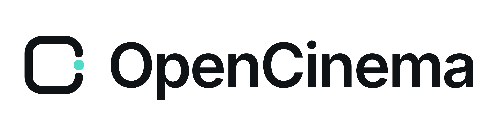
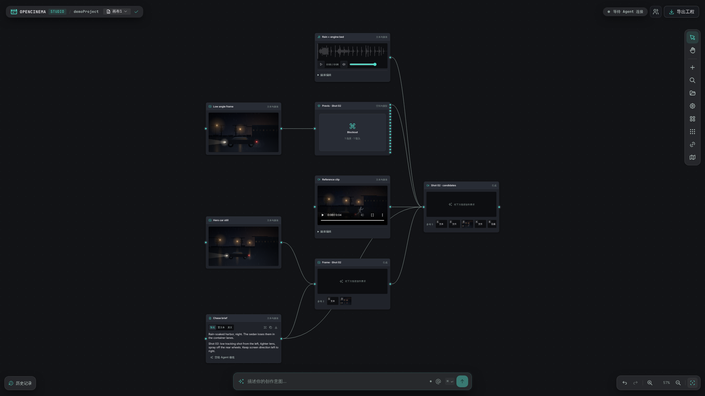
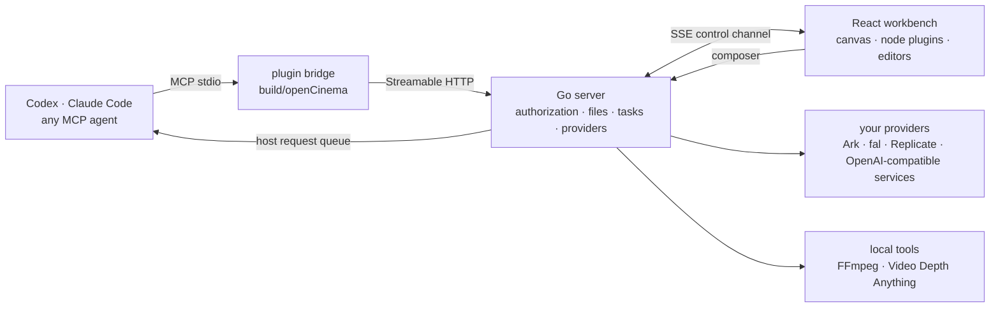
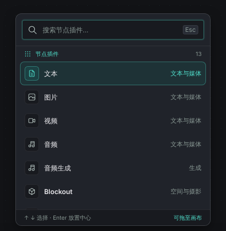
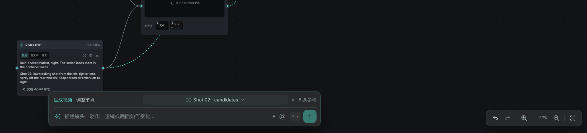
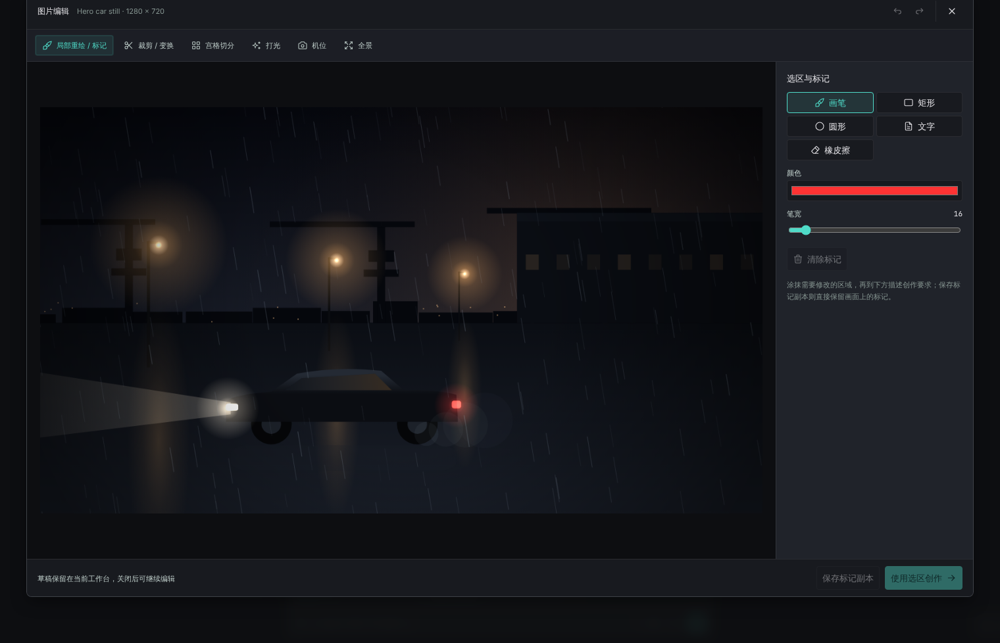
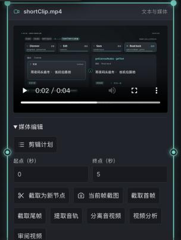
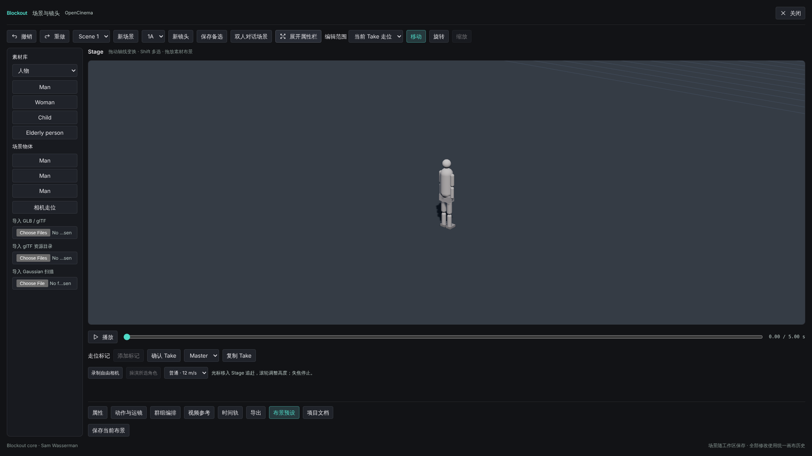
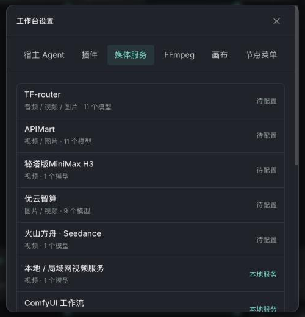
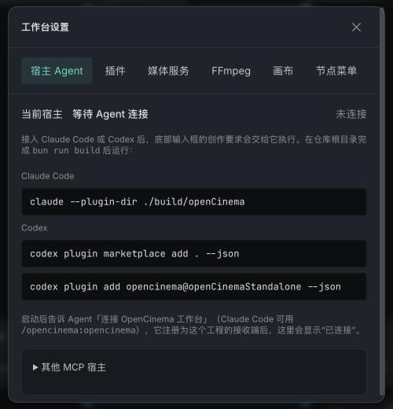

  <picture>
    <source media="(prefers-color-scheme: dark)" srcset="assets/brand/logoDark.png">
    
  </picture>

<h3 align="center">Your agent. Your canvas. Your film.</h3>

  A local AI video workbench. 
  Codex, Claude Code or any MCP agent handles planning and conversation. OpenCinema provides the node canvas, image and video tools, 3D previs, shot review and the final edit.

  
  
  
  
  
  

  <a href="readme.md">中文</a> ·
  <a href="https://opencinema.site">opencinema.site</a> ·
  <a href="#quick-start">Quick start</a> ·
  <a href="#features">Features</a> ·
  <a href="#architecture">Architecture</a> ·
  <a href="#ecosystem-and-extension">Extend</a> ·
  <a href="#contributing">Contribute</a> ·
  <a href="assets/promo/openCinemaLaunch.mp4">Launch film · 30 s</a>

  

Real interface screenshot, sample project “Harbor Chase”. Generated results depend on the models, references and reviews you configure.

## What OpenCinema is

- **One canvas for the whole film.** Script, references, white-model previs, image and video generation, review and the edit plan are nodes on one canvas; edges are reference relationships.
- **Your agent works on the same canvas.** Describe what you want in Codex, Claude Code or any MCP client; the agent reads and writes nodes through public MCP tools. Open an editor and change things by hand whenever you like. Both paths share one command path, one revision and one undo history.
- **Everything stays local.** The Go server listens on loopback only, a project is a plain folder on your disk, and provider credentials live in local settings. Agents only ever see “configured / not configured”.

> **Status: 0.4.0, in development, unreleased.** Source builds work on macOS and Linux; Windows archives are not supported yet. AI generation uses the provider you configure and may cost money. No host subscription includes any video model.

## How it works

An agent first calls `getAppState` to pin the project and canvas, then discovers tools from their live schemas and executes them. Side-effecting calls carry an `operationId`; canvas writes carry `expectedRevision`. The full contract is in the [architecture document](docs/architecture.md) (Chinese).

## Features

### The canvas and 13 node plugins

<table>
<tr>
<td width="34%"></td>
<td valign="top">

Press <kbd>Tab</kbd> for the node palette, or drop files straight onto the canvas. Nodes connect by port type (text, image, video, audio, file); sources wired into a generation node appear as numbered references.

| Category | Nodes |
| --- | --- |
| Text and media | Text · Image · Video · Audio |
| Generation | Image generation · Video generation · Audio generation |
| Space and camera | Blockout · 3D Director |
| Analysis | Frame analysis (cut detection) · Motion analysis · Video depth · Media info |
| Workspace extension | Collaboration |

Grouping, auto-arrange, batch connect, undo/redo, history and save are built into the canvas and shared by agents and people.
</td>
</tr>
</table>

### You set the scope

Select one node and the composer acts on it alone. Marquee-select a group and the scope becomes “these N nodes”. Select nothing and it is the whole canvas. Generation nodes can switch between “generate” and “let the agent adjust this node”. In the plain web page the composer needs an online host agent to receive the request (see [Connect your agent](#connect-your-agent)).

### Editors

<table>
<tr>
<td width="68%"></td>
<td valign="top"></td>
</tr>
</table>

- **Images**: inpaint with marks, crop and transform, grid split, lighting, camera angle, panorama. Paint a selection first, then hand the request to the composer; only the selected region changes.
- **Video**: trim to a new node, capture first/last/current frame, extract audio, separate audio and video, change speed, frame analysis, transcription, plus the entry points for review and the edit plan.
- **Audio**: waveform clip editor with preview. All processing runs through local FFmpeg; results become new nodes and the source stays untouched.

### Blockout: see the shot before you generate

Place characters and set pieces on a white-model stage, block the action, record camera moves, and export RGB, Depth and Normal layers per shot plus a full animatic. “Freeze as shot reference” turns an export into reference nodes wired into video generation. The white model and depth are **references** for framing and motion rhythm; an ordinary video reference does not make a model reproduce motion exactly.

### Analysis

- **Frame analysis**: detects cut points and splits a clip into keyframes, shot segments and the audio track, placed on the canvas as groups.
- **Motion analysis**: pose skeleton and 2D camera motion, optional relative depth, exportable production pack. It is not a 3D camera solve.
- **Video depth**: temporal relative depth from a locally prepared Video Depth Anything Small model, usable as a control-type reference.

### Generation plan, review and edit plan

- **See the plan first.** `getGenerationPlan` returns the final prompt, the actual model parameters, the role of every reference (`instruction` / `identity` / `composition` / `motion` / `exclude`) and the request slot, without paying or submitting anything.
- **Review is a recorded human decision.** Six checks: direction, action, identity, continuity, unexpected cuts, deformation/branding. A candidate is `approved` only when every check passes and a note is written; `rejected` keeps the clip. The software never judges quality for you.
- **Replace one shot, keep the rest.** The edit plan stores 2–16 clips with order, in/out points, output spec and one audio track. It is saved as a whole under a plan revision; replacing a single clip leaves the others untouched, and rendering creates a new output node while the old one stays.

### Your models, your tools

<table>
<tr>
<td width="36%"></td>
<td valign="top">

- **Video providers**: Volcengine Ark Seedance, fal, Replicate, local or LAN OpenAI-compatible video services, and several relay services. Custom providers are imported as JSON manifests.
- **FFmpeg**: use a system install or a per-platform, SHA-pinned download; every command runs through filter and option allowlists.
- **Depth model**: the Python environment and weights are prepared explicitly, pinned by commit and SHA. Builds never download models behind your back.
- Credentials are entered only in the local settings panel. A configured credential does not mean the account is authenticated, billing is authorised or generation has been verified.

See [video providers](docs/videoProvider.md) and the [shot workflow](docs/videoShotWorkflow.md) (both Chinese).
</td>
</tr>
</table>

## Quick start

### Requirements

| For | You need |
| --- | --- |
| Building from source | Bun 1.3.14+, Go 1.26+, Node.js 22+ |
| Running a full release package | Node.js 22+ only |
| Local media processing | FFmpeg / FFprobe (downloadable from settings) |
| Video depth (optional) | Python 3.10–3.12 |

### Run from source

~~~sh
git clone https://github.com/junjamrk/OpenCinema.git
cd OpenCinema
bun install --frozen-lockfile
bun run build
bun start
~~~

Open [http://127.0.0.1:47920](http://127.0.0.1:47920), click “Open project” and enter the absolute path of any folder. Drop images, video and audio onto the canvas to create nodes; the project folder gets a canvas JSON file and an `assets/` directory.

### Connect your agent

<table>
<tr>
<td width="36%"></td>
<td valign="top">

**Claude Code** (from a built checkout):

~~~sh
claude --plugin-dir ./build/openCinema
~~~

Or install it as a plugin for this project:

~~~sh
claude plugin marketplace add ./ --scope local
claude plugin install opencinema@openCinemaStandalone --scope local
~~~

Invoke `/opencinema:opencinema`; the agent reads `getAppState` first, then opens your project.

**Codex**:

~~~sh
codex plugin marketplace add . --json
codex plugin add opencinema@openCinemaStandalone --json
~~~

Hosts that support MCP Apps can open the workbench inside the conversation with `renderOpenCinema`.

**Other MCP clients**: copy the MCP connection configuration from the “Host agent” tab in settings. The connection name is `openCinemaStudio`.
</td>
</tr>
</table>

The composer in the plain web page needs an online host: the agent calls `registerHost` to announce what it can do, polls `pollHostRequests` within its lease to pick up requests, executes them through the canvas tools and reports back with `completeHostRequest`. Step-by-step notes are in [Claude setup](docs/claudeSetup.md) (Chinese).

### A typical session

1. Open a project, drop in reference stills, a reference clip and an audio bed, and write a short brief.
2. Block the action and the camera in Blockout, export RGB/Depth for the shot and freeze them as reference nodes.
3. Wire the brief, the still and the previs into a video generation node and set the reference roles.
4. Type the request into the composer, for example “make the chase feel faster”. The agent shows the generation plan first; confirm, then generate candidates.
5. Review each candidate; rejected ones stay in the project.
6. In the edit plan, replace only the shot that failed, add the audio track and render a new cut.

## Architecture

| Layer | Where | Responsibility |
| --- | --- | --- |
| Go server | `apps/server` | Authorization and path boundaries, atomic file writes, the MCP endpoint and `operationId` records, media tasks and provider protocols, FFmpeg and the depth model, collaboration |
| React workbench | `apps/web` | The canvas (@xyflow/react), node views, editors, the tool catalog, the SSE control channel to Go |
| Editing session | `packages/workbenchCore` | Framework-independent document, revisions, undo/redo and the save queue |
| Node SDK | `packages/nodeScaffold` · `packages/nodeShared` | Plugin contract, Zod tool registration, build output, cross-plugin business (generation, review, edit plan) |
| Node plugins | `packages/nodes/*` | 14 built-in nodes and extensions |
| MCP bridge and plugin package | `packages/mcp` · `packages/openCinema` | stdio adapter, widget resource, launcher and leases, Codex/Claude manifests and skill |

Three invariants hold the design together: **one source of truth for schemas** (Zod → JSON Schema → Go → stdio), **one command path for people and agents** with shared revisions and undo, and **traceable side effects** (`operationId` idempotency, `unknown` is never retried automatically, outputs carry provenance and review records). The full description and an engineering assessment are in [docs/architecture.md](docs/architecture.md) (Chinese).

## Ecosystem and extension

### Write a node

A node is a standalone package exporting a `NodePluginDefinition`. Tools are declared with Zod, and the UI and agents call the same implementation:

~~~ts
// packages/nodes/myNode/src/reactPlugin.ts
import { z } from "zod";
import type { NodePluginDefinition } from "@toonflow/nodes-scaffold";
import { MyNodeView } from "./reactView";

const plugin: NodePluginDefinition = {
  apiVersion: 1, id: "myNode", name: "My node", version: "1.0.0", renderer: "react",
  view: MyNodeView,
  createData: () => ({ handles: [{ type: "target", id: "in", dataType: "IMAGE" }, { type: "source", id: "out", dataType: "IMAGE" }] }),
  activate(ctx) {
    ctx.registerTool({
      name: "describe", description: "Read the current input and return a summary",
      parameters: z.object({ detail: z.enum(["short", "full"]).default("short") }),
      annotations: { readOnlyHint: true },
      execute: async ({ detail }) => ({ summary: await summarise(ctx, detail) }),
    });
  },
};
export default plugin;
~~~

`vite.config.ts` is one line, `createNodeConfig({ name: "myNode", displayName: "My node", author, github }, import.meta.url)`. `bun run build` writes `build/nodes/myNode/install.json` (manifest, ESM and assets with SHA-256). Install it from the “Plugins” tab in settings, or let an agent call `reviewPluginPackage` → `installPluginPackage`. The full contract is in the [node SDK](packages/nodeScaffold/readme.md) (Chinese).

### Add a provider

A service that speaks one of the existing protocols (`openaiVideo` / `fal` / `replicate` / `ark`) needs only a JSON manifest, no code:

~~~json
{
  "id": "remoteVideo",
  "label": "My video service",
  "apiUrl": "https://video.example.com/v1",
  "videoProtocol": "openaiVideo",
  "transport": "public",
  "rules": [{ "field": "apiKey", "title": "API Key", "type": "input", "props": { "type": "password" } }],
  "models": [{ "id": "deployedModel", "label": "Deployed model", "type": "video", "mode": ["text", "endFrameOptional"],
               "durationResolutionMap": [{ "duration": [4, 8], "resolution": ["720p"] }],
               "video": { "inputMap": { "firstFrame": "input_reference" } } }]
}
~~~

Reference media without a declared mapping is rejected explicitly rather than dropped; secrets stay on the server. See [video providers](docs/videoProvider.md).

### The agent tool surface

| Tier | Discovery | Contents |
| --- | --- | --- |
| Core tools | `tools/list` | `getAppState`, `renderOpenCinema`, canvas read/write, `workspaceFiles`, `readWorkspaceImage`, `getOperation`, the host request queue |
| Workbench extensions | `getWorkbenchTools` → `workbenchTools` | Grouping, arranging, canvas management, asset library, provider and plugin management, FFmpeg and depth-model configuration |
| Node and workspace plugins | `getNodeTools` / `getWorkspaceTools` → `nodeTools` / `workspaceTools` | Shot plan, generation, review, edit plan, Blockout, motion analysis and other specialist functions |

Every tier has live schemas, output validation and `annotations`; errors carry a machine code and a recovery action. See the [MCP SDK](packages/mcp/README.md) and the [plugin notes](packages/openCinema/readme.md) (Chinese).

### Release packages

`bun run release` archives an existing `build/openCinema` as `openCinema-<version>-<platform>-<arch>.zip` with checksums and a manifest. The unpacked folder needs only Node.js 22+ to load as a plugin. See the [release guide](docs/releaseGuide.md) (Chinese).

## Contributing

~~~sh
bun install --frozen-lockfile
bun run dev:web        # Vite dev server
bun run dev:server     # go run, listening on 127.0.0.1:47920
bun run typecheck      # web, core, MCP, plugin and go vet
bun run build          # full build
~~~

- Read the [contributing guide](contributing.md) first: lowerCamelCase names (PascalCase for components), canvas edits only through public commands or MCP tools, file operations through `@toonflow/file`, no bypassing public package exports.
- A pull request should state the problem, the final behaviour, the entry points and boundaries it touches, and the commands you actually ran with evidence: before/after screenshots for UI changes, discovery/call/save/read-back results for agent capabilities, real output specs for media tasks. Templates: [pull request](docs/pullRequestTemplate.md), [issue](docs/issueTemplate.md).
- Welcome directions: node and provider examples, English tool descriptions and interface strings, documentation and tutorials, performance on large canvases and media previews, Windows verification.
- Security issues follow [security.md](security.md); community interaction follows the [code of conduct](codeOfConduct.md). [Issues](https://github.com/junjamrk/OpenCinema/issues) · [Changelog](changelog.md)

## Launch film

[Watch the 30-second launch film](assets/promo/openCinemaLaunch.mp4). Every frame in it is drawn in code; nothing was produced by a video model. The [storyboard](docs/launchVideoStoryboard.md) and the [source](assets/promo/launchVideo/readme.md) are in the repository. The earlier 58-second product concept film is at [assets/promo/openCinemaPromo.mp4](assets/promo/openCinemaPromo.mp4).

## License and acknowledgements

[MIT](LICENSE), preserving the HBAI-Ltd copyright. Blockout and Motion are adapted from Sam Wasserman's tools of the same names (Apache-2.0); fonts, icons, model weights, FFmpeg builds and user media keep their own terms, see the [third-party notices](thirdPartyNotices.md). The distribution and documentation approach references [Cowart](https://github.com/zhongerxin/Cowart).
