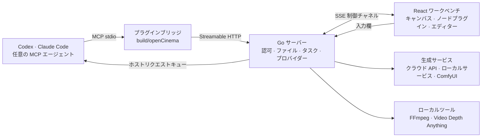

<p align="center">
  <picture>
    <source media="(prefers-color-scheme: dark)" srcset="assets/brand/logoDark.png">
    
  </picture>
</p>

<h3 align="center">あなたのエージェント。あなたのキャンバス。あなたの映画。</h3>

<p align="center">
  ローカルファーストの AI 映像制作スタジオ。絵コンテ、素材、3D プレビズ、生成、編集を一つのキャンバスでつなぎ、<br>
  手で行った作業はすべて、エージェントが同じツールで引き継げます。
</p>

<p align="center">
  <a href="LICENSE"></a>
  
  
  
  
  
</p>

<p align="center">
  <a href="readme.md">English</a> ·
  <a href="readmeZh.md">中文</a> ·
  <strong>日本語</strong>
</p>

<p align="center">
  <a href="https://opencinema.site">opencinema.site</a> ·
  <a href="#クイックスタート">クイックスタート</a> ·
  <a href="#機能">機能</a> ·
  <a href="roadmap.md">Roadmap</a> ·
  <a href="#アーキテクチャ">アーキテクチャ</a> ·
  <a href="#opencinema-を拡張する">拡張</a> ·
  <a href="#コントリビュート">コントリビュート</a> ·
  <a href="assets/promo/openCinemaLaunch.mp4">ローンチフィルム · 30 秒</a>
</p>

<p align="center">
  
</p>
<p align="center"><sub>サンプルプロジェクトの実際の画面です。生成結果は、設定したモデル、参照素材、レビューによって変わります。</sub></p>

## なぜ OpenCinema か

生成ツールは「このカットをどう作るか」に答えます。OpenCinema は「この映画をどう完成させるか」に答えます。

- **先にプレビズ、次に生成、直すのは必要なカットだけ。** 3D で動きとカメラを決め、カットごとにレビューし、全体を作り直さずに一つのカットだけ差し替えられます。
- **一つのキャンバスで映画全体を扱う。** 脚本、参照素材、プレビズ、生成、レビュー、編集プランはすべてキャンバス上のノードで、エッジは参照関係を表します。
- **エージェントも同じキャンバスで作業する。** Codex、Claude Code、または任意の MCP クライアントで指示すると、エージェントは公開 MCP ツールでノードを読み書きします。手作業での修正もいつでもできます。どちらも同じコマンド経路、リビジョン、取り消し履歴を共有します。
- **生成バックエンドを入れ替えられる。** クラウドモデル、ローカルサービス、既存の ComfyUI ワークフローを同じ生成ノードに接続できます。
- **すべてローカルに留まる。** Go サーバーはループバックのみで待ち受け、プロジェクトはディスク上の普通のフォルダです。認証情報はローカル設定に保存され、エージェントから見えるのは「設定済み」か「未設定」だけです。

> **現在の状態：0.4.0 開発中、未リリース。** macOS と Linux ではソースからビルドできます。Windows 向けアーカイブは未対応です。ワークベンチの画面は現在中国語のみのため、以下のボタン名には日本語訳を併記しています。AI 生成は設定したプロバイダーを使うため、料金が発生する場合があります。詳しくは[既知の制限](#既知の制限)を参照してください。

## 仕組み



エージェントはまず `getAppState` でプロジェクトとキャンバスを固定し、ライブスキーマからツールを見つけて実行します。副作用のある呼び出しには `operationId` を、キャンバスへの書き込みには `expectedRevision` を付けます。競合は拒否され、結果が不明な場合はやみくもに再試行せず元の操作を照会します。

## クイックスタート

### 1. 必要なもの

| ツール | バージョン | 用途 |
| --- | --- | --- |
| [Bun](https://bun.sh) | 1.3.14+ | 依存関係のインストール、Web とプラグインのビルド |
| [Go](https://go.dev/dl/) | 1.26+ | ローカルサーバーのコンパイル |
| [Node.js](https://nodejs.org) | 22+ | Claude Code と Codex の連携時のみ。リリースパッケージの実行にはこれだけで足ります |
| FFmpeg | 任意 | 音声と動画の処理。なければ **設定 → FFmpeg** からダウンロードできます |
| Python | 3.10–3.12、任意 | Video Depth ノードでのみ使用 |

### 2. ビルドと起動

```bash
git clone https://github.com/junjamrk/OpenCinema.git
cd OpenCinema
bun install --frozen-lockfile
bun run build
bun start
```

<http://127.0.0.1:47920> を開きます。サーバーはローカルホストのみで待ち受けます。設定と認証情報はリポジトリ内の `data/` に保存され、Git の管理対象外です。

### 3. プロジェクトを開く

**打开工程**（プロジェクトを開く）をクリックし、既存フォルダの絶対パス（例：`/Users/me/Movies/myFilm`）を入力します。空のフォルダでも構いません。最初のキャンバスは自動で作成されます。以降はホーム画面の最近のプロジェクトからすぐに開けます。

### 4. 生成方法を選ぶ

両方を併用でき、ノードごとにいつでも切り替えられます。

| | メディアプロバイダーを設定 | エージェントを接続 |
| --- | --- | --- |
| 向いている用途 | モデルを直接呼び出す | 計画、キャンバス構築、一括作業 |
| 必要なもの | プロバイダーの API キーまたはローカルサービス | Claude Code、Codex、その他の MCP クライアント |
| 費用 | プロバイダーの従量課金 | ホストのサブスクリプションがすべての動画モデルを含むわけではありません |

**メディアプロバイダーを設定する**

1. **设置 → 媒体服务**（設定 → メディアサービス）を開きます。各プロバイダーの設定状況が一覧で表示されます。
2. プロバイダーを選び、API キーを入力して接続を保存します。
3. 生成ノードでパラメーターボタンをクリックし、モデルを選びます。

**エージェントを接続する**

<table>
<tr>
<td width="36%"></td>
<td valign="top">

Claude Code の場合は、ビルド済みリポジトリのルートで実行します。

```bash
claude --plugin-dir ./build/openCinema
```

Codex の場合：

```bash
codex plugin marketplace add . --json
```

```bash
codex plugin add opencinema@openCinemaStandalone --json
```

次に、エージェントに OpenCinema ワークベンチへの接続を依頼します。Claude Code では `/opencinema:opencinema` も使えます。ワークベンチ右上に接続済みと表示されると、下部の入力欄の指示がエージェントに渡ります。

その他の MCP クライアントは **设置 → 宿主 Agent**（設定 → ホストエージェント）から接続設定をコピーできます。詳しくは [Claude セットアップ](docs/claudeSetup.md)（中国語）を参照してください。
</td>
</tr>
</table>

> ワークベンチのページは開いたままにしてください。キャンバスとノードのツールはページ内で動作し、エージェントはそれを通じてキャンバスを操作します。

### 5. 最初のカットを作る

1. 画像をキャンバスにドラッグします。
2. `Tab` を押して **视频生成**（動画生成）を選びます。
3. 画像ノードの右側のポートから、生成ノードの左側のポートへ線を引きます。
4. 生成ノードを選択し、上部のパラメーターボタンからモデル、尺、アスペクト比を選びます。
5. 下部の入力欄にカットの内容を書き、`⌘/Ctrl + Enter` を押します。

ノードに進行状況が表示され、完成した動画はプロジェクトの `assets/` に保存されます。その後はフレームの書き出し、テイクのレビュー、次のノードへの接続ができます。

### 典型的な制作の流れ

1. プロジェクトを開き、参照画像、参照動画、音声を入れ、短い説明を書きます。
2. Blockout で動きとカメラを組み立て、そのカットの RGB と Depth を書き出して参照ノードに固定します。
3. 説明、静止画、プレビズを動画生成ノードにつなぎ、参照の役割を設定します。
4. 入力欄に「追跡シーンをもっと速く感じさせて」のように指示します。エージェントが先に生成プランを示すので、確認してから候補を生成します。
5. 候補を一つずつレビューします。却下したものもプロジェクトに残ります。
6. 編集プランで不合格のカットだけを差し替え、音声トラックを加えて新しいカットをレンダリングします。

### トラブルシューティング

| 症状 | 対処 |
| --- | --- |
| 送信ボタンが押せない | 入力欄の下のヒントを読み、エージェント接続またはモデル設定のボタンを使う |
| 選べるモデルがない | **设置 → 媒体服务** でプロバイダーを設定するか、カスタムプロバイダーを追加する |
| 音声・動画処理が失敗する | **设置 → FFmpeg** からダウンロードするか、システムのインストール版に切り替える |
| ポート 47920 が使用中 | `build/server/openCinema -listen 127.0.0.1:47921 -webRoot build/web -dataDirectory data` を実行する |
| エージェントがワークベンチへの接続を求める | ワークベンチのページを開いてプロジェクトに入り、エージェントに状態を読み直してもらう |

## 機能

### キャンバスと 13 のノードプラグイン

<table>
<tr>
<td width="34%"></td>
<td valign="top">

<kbd>Tab</kbd> でノードパレットを開くか、ファイルをキャンバスに直接ドロップします。ノードはポートの型で接続し、生成ノードにつないだ素材は番号付きの参照として表示されます。

| カテゴリ | ノード |
| --- | --- |
| テキストとメディア | テキスト · 画像 · 動画 · 音声 |
| 生成 | 画像生成 · 動画生成 · 音声生成 |
| 空間とカメラ | Blockout · 3D Director |
| 分析 | 動画分析 · メディア情報 · Motion · Video Depth |
| ワークスペース拡張 | コラボレーション |

複数キャンバス、グループ、整列ガイド、グリッドスナップ、自動整列、一括接続、取り消しとやり直しは標準機能で、エージェントと人が共有します。ショートカットとノードメニューは設定で変更できます。
</td>
</tr>
</table>

### 範囲はあなたが決める


ノードを一つ選ぶと入力欄はそのノードだけに作用します。範囲選択するとそれらのノードが対象になり、何も選ばなければキャンバス全体が対象です。生成ノードでは、生成とエージェントによるノード調整を切り替えられます。

### エディター

<table>
<tr>
<td width="68%"></td>
<td valign="top"></td>
</tr>
</table>

どの操作も新しいコピーまたはノードを作成し、元の素材は残ります。

- **画像**：ブラシや矩形選択による部分再描画、マークアップ、切り抜きと変形、グリッド分割、ライティング、カメラアングル、パノラマ。ライティングとカメラの結果は生成の下書きになります。
- **動画**：新しいノードへの切り出し、先頭・末尾・現在フレームの書き出し、音声抽出、音声と映像の分離、速度変更、動画分析、文字起こし、レビューと編集プランへの入口。
- **音声**：波形編集、セグメント結合、速度変更、文字起こし。処理はローカルの FFmpeg で行います。

### Blockout：生成の前にカットを確かめる


ホワイトモデルのステージにキャラクターや物を配置し、動きを組み立て、カメラの動きを記録して、カットごとの RGB、Depth、Normal レイヤーと全体のアニマティックを書き出します。固定した書き出しは参照ノードになり、動画生成につなげられます。3D Director ノードはテキストからアニメーション案を生成し、フレーミングは手で行います。

ブロックアウトと相対深度は、構図と動きのリズムのための**参照**です。通常の動画参照では、モデルが動きを正確に再現するとは限りません。

### 分析

- **動画分析**：カット点を検出し、キーフレーム、ショット、音声トラックに分割します。Python やモデル API は不要です。
- **Motion**：30 秒までの動画の骨格推定と 2D モーション分析。相対深度は任意で、制作パックとして書き出せます。3D カメラソルブではありません。
- **Video Depth**：ローカルに準備した Video Depth Anything Small で時系列の相対深度を生成します。ビルド時にモデルをダウンロードすることはありません。
- **メディア情報**：コーデック、尺、フレームレート、トラックをローカルで確認します。アップロードはしません。

### 生成プラン、レビュー、編集プラン

- **先にプランを見る。** `getGenerationPlan` は最終プロンプト、実際のモデルパラメーター、各参照の役割を、課金も送信もせずに返します。
- **レビューは人の判断の記録。** 方向、動作、同一性、連続性、意図しないカット、変形の六項目を確認します。却下または未レビューのクリップは合成に使えません。品質を判断するのはソフトウェアではなくあなたです。
- **一つのカットだけ差し替える。** 編集プランは 2〜16 クリップの順序、イン点とアウト点、形式、一本の音声トラックを保存します。一つ差し替えても他のクリップは変わらず、レンダリングは新しい出力ノードを作成します。

詳しくは[ショットワークフロー](docs/videoShotWorkflow.md)（中国語）を参照してください。

### あなたのモデル、あなたのツール

<table>
<tr>
<td width="36%"></td>
<td valign="top">

画像、動画、音声の生成は、ホストエージェントでも設定済みモデルでも実行できます。

| プロバイダー | 画像 | 動画 | 音声 |
| --- | --- | --- | --- |
| TF-router | ✓ | ✓ | ✓ |
| APIMart | ✓ | ✓ | |
| Compshare | ✓ | ✓ | |
| Metaso MiniMax H3 | | ✓ | |
| Volcengine Ark Seedance | | ✓ | |
| fal | ✓ | ✓ | ✓ |
| Replicate | ✓ | ✓ | ✓ |
| ローカル／LAN 動画サービス | | ✓ | |
| ComfyUI ワークフロー | ✓ | ✓ | ✓ |
| カスタム | ✓ | ✓ | ✓ |
</td>
</tr>
</table>

- **fal と Replicate のプリセット**：fal には Kling、FLUX、ElevenLabs、Replicate には Veo、FLUX、MiniMax Speech を用意しています。他のモデルは設定から追加できます。
- **再起動してもタスクは続く**：切断やサーバー再起動の後、fal、Replicate、Ark、OpenAI 形式、ComfyUI、`httpTask`、`adapter` のタスクは、新たな有料リクエストを送らずに元のタスクの監視を再開します。成果物はプロジェクトにダウンロードされ、FFprobe で検証されてから完了となります。
- **FFmpeg**：システムのインストール版か、プラットフォーム別に SHA で固定されたダウンロード版を使います。コマンドはフィルターとオプションの許可リストを通して実行されます。
- **認証情報**はローカルの設定パネルでのみ入力します。設定済みであることは、認証済み、課金承認済み、生成検証済みを意味しません。

詳しくは[プロバイダードキュメント](docs/videoProvider.md)（中国語）を参照してください。

### ComfyUI ワークフロー

生成は ComfyUI が行い、OpenCinema は各ワークフローをモデルとして扱います。マニフェストを書く必要はありません。

1. ComfyUI でワークフローを動かしてから **Export (API)** を選びます。通常のキャンバス保存形式はインポートできません。
2. **设置 → 媒体服务 → ComfyUI 工作流** を開き、接続を有効にしてアドレス（既定は `http://127.0.0.1:8188`）を入力し、**保存并检测**（保存して確認）をクリックします。
3. **导入工作流**（ワークフローをインポート）をクリックし、プロンプトを受け取るノードを確認して、各ローダーノードを先頭フレーム、末尾フレーム、参照、そのまま のいずれかに指定します。
4. 生成ノードでワークフローを選びます。エージェントも同じノードツールで利用します。

ワークフローはブラックボックスとして実行されます。確認した入力だけが置き換えられ、`seed` と `noise_seed` は送信のたびに変わり、出力は保存ノードを通す必要があります。インポート時にアスペクト比や尺を追加し、ノード上で調整する項目を選べます。

> ワークフローは ComfyUI 上で動作し、カスタムノードは任意のコードを実行できます。信頼できるワークフローのみをインポートしてください。エージェントのツールではワークフローを追加・変更できず、設定画面からあなたがインポートする必要があります。

### コラボレーションとプロジェクト管理

- **コラボレーション**：同一サーバー上のキャンバス共同編集。期限付きの編集・閲覧招待、ユーザーごとの取り消し、再接続に対応します。公開サービスの起動や文字単位の共同編集は行いません。
- **アセットライブラリ**：プロジェクトをまたぐグローバル素材で、どのキャンバスにもドラッグできます。
- **プロジェクトの書き出し**：キャンバスと素材を含むアーカイブとしてダウンロードできます。
- **メディア履歴**：メディアノードは生成履歴を保持し、いつでも切り替えられます。

## アーキテクチャ

| レイヤー | 場所 | 役割 |
| --- | --- | --- |
| Go サーバー | `apps/server` | 認可とパス境界、アトミックなファイル書き込み、MCP エンドポイントと `operationId` の記録、メディアタスクとプロバイダープロトコル、FFmpeg と深度モデル、コラボレーション |
| React ワークベンチ | `apps/web` | キャンバス（@xyflow/react）、ノードビュー、エディター、ツールカタログ、Go との SSE 制御チャネル |
| 編集セッション | `packages/workbenchCore` | フレームワーク非依存のドキュメント、リビジョン、取り消しとやり直し、保存キュー |
| ノード SDK | `packages/nodeScaffold` · `packages/nodeShared` | プラグイン契約、Zod によるツール登録、ビルド出力、生成・レビュー・編集プランなどのプラグイン横断ロジック |
| ノードプラグイン | `packages/nodes/*` | 13 の組み込みノード、コラボレーション拡張、Gaussian Splat マーケットプラグイン |
| MCP ブリッジとプラグインパッケージ | `packages/mcp` · `packages/openCinema` | stdio アダプター、ウィジェットリソース、ランチャーとリース、Codex と Claude のマニフェストとスキル |

設計を支える不変条件は三つです。**スキーマの情報源は一つ**（Zod → JSON Schema → Go → stdio）、**人とエージェントは同じコマンド経路を通り**、リビジョンと取り消しを共有する、そして**副作用を追跡できる**（`operationId` の冪等性、`unknown` は自動再試行しない、成果物に出所とレビュー記録が残る）。

## OpenCinema を拡張する

### ノードプラグインを作る

OpenCinema の大部分はプラグインで構成され、13 の組み込みノードもプラグインです。プラグインはワークベンチのページで動く ESM モジュールで、ポートでデータを交換し、機能をツールとして公開します。ボタンもエージェントも同じツールを呼び出し、エージェントはプロトコルを変更せずにそれを発見できます。

プラグインはこのリポジトリの外で開発できます。スキャフォールドはまだ npm にないため、先にリポジトリのルートでパックします。

```bash
cd packages/nodeScaffold && npm pack
```

プラグインを置く場所でプロジェクトを生成します。`<repo>` は実際のパスに置き換えてください。

```bash
npx --yes --package <repo>/packages/nodeScaffold/toonflow-nodes-scaffold-0.4.0.tgz createOpenCinemaPlugin helloNode --name "Word Count" --scaffold file:<repo>/packages/nodeScaffold/toonflow-nodes-scaffold-0.4.0.tgz
```

依存関係をインストールし、検査してビルドします。

```bash
cd helloNode && npm install && npm run typecheck && npm run build
```

**设置 → 插件 → 安装插件包**（設定 → プラグイン → パッケージをインストール）を開き、`dist/install.json` を選びます。

<details>
<summary>例：上流テキストの文字数を数えるノード</summary>

`package.json` の `openCinema` ブロックでプラグインを宣言します。`getService` は `requires` に記載したサービスだけを返します。

```json
"openCinema": {
  "id": "helloNode",
  "name": "Word Count",
  "description": "上流テキストの文字数を数えます",
  "category": "テキストとメディア",
  "requires": { "workbench": 1 }
}
```

`src/reactPlugin.ts`：

```ts
import { z } from "zod";
import type { NodePluginDefinition } from "@toonflow/nodes-scaffold/contracts";
import type { NodeWorkbenchService } from "@toonflow/nodes-scaffold/workbenchServices";
import { openCinema, version } from "../package.json";
import PluginView from "./reactView";

const plugin: NodePluginDefinition<typeof PluginView> = {
  ...openCinema, version, apiVersion: 1, renderer: "react", view: PluginView,
  createData: () => ({ label: openCinema.name, handles: [
    { id: "text", type: "target", dataType: "STRING", label: "テキスト" },
    { id: "count", type: "source", dataType: "STRING", label: "文字数" },
  ], outputs: {} }),
  activate(context) {
    const workbench = context.getService<NodeWorkbenchService>("workbench");
    context.registerTool({
      name: "countText", description: "上流テキストの文字数を数え、結果を文字数の出力に書き込みます。",
      parameters: z.strictObject({}),
      outputSchema: z.strictObject({ count: z.number().int().nonnegative() }),
      annotations: { readOnlyHint: false, destructiveHint: false, idempotentHint: true, openWorldHint: false },
      async execute(_args, { signal }) {
        workbench.assertWritable();
        const text = workbench.getInputs("text").map(input => String(input.value ?? "")).join("");
        await workbench.updateData({ outputs: { count: { dataType: "STRING", value: String(text.length) } } }, undefined, signal);
        return { count: text.length };
      },
    });
  },
};

export default plugin;
```

`src/reactView.tsx`：

```tsx
import type { ReactNodeViewProps } from "@toonflow/nodes-scaffold/react";

export default function PluginView({ node, controller, readOnly }: ReactNodeViewProps) {
  const outputs = node.data?.outputs as { count?: { value?: string } } | undefined;
  return <div className="nodrag">
    <button type="button" disabled={readOnly} onClick={() => void controller.callNodeTool(node.id, "countText", {})}>数える</button>
    <span>{outputs?.count?.value ?? "未集計"}</span>
  </div>;
}
```

インストールすると **Word Count** がノードパレットに表示され、`getNodeTools` は `node:countText` とそのスキーマを返します。
</details>

<details>
<summary>プラグインの構成とコードの置き場所</summary>

| 要素 | 役割 |
| --- | --- |
| `createData` | ノードの初期データとポート。ポートの型には `STRING`、`IMAGE`、`VIDEO`、`AUDIO`、`FILE` があります |
| `view` | React ビュー |
| `registerTool` | Zod パラメーター付きのツールを公開 |
| `composer` | 任意。下部の入力欄と連携 |
| `requires` | 必要なサービスとホスト機能（`workbench`、`workspaceFiles`、`ffmpeg` など） |
| `category`、`description` | ノードパレットでの分類と説明 |
| `onDispose` | Worker やリスナーなどのリソースを解放 |

ノード固有のロジックはそのプラグインに、複数のプラグインで共有するロジックは `packages/nodeShared` に、汎用の契約は `packages/nodeScaffold` に置きます。

組み込みノードとして提供するには、`packages/nodes/<id>/` に移動し、`@toonflow/nodes-scaffold/reactBuild` からビルド設定を読み込み、`outDir: "../../../build/nodes/<id>"` を設定し、`openCinema` ブロックに `order` を追加します。さらにワークスペース依存を [`apps/web/package.json`](apps/web/package.json) に追加し、`bun run generate:nodes` を実行します。
</details>

プラグインは生成サービスも提供できます。`viteConfig.ts` で `providers` を宣言すると、下記のマニフェストと同じ形式で、インストール時に同じ検証を受けます。

> インストールしたプラグインはページ内で動作します。`requires` が制限するのは `getService` だけでサンドボックスではなく、プラグインはワークスペースを読み書きできます。信頼できるパッケージのみをインストールしてください。

完全な契約は[ノード SDK](packages/nodeScaffold/readme.md)（中国語）を参照してください。

このリポジトリ内にプラグインを追加するには `bun packages/nodeScaffold/scripts/createNode.ts myNode "My node"` を実行します。そのままビルドしてインストールできるスケルトンが生成され、エージェント向けの `agent.md` も含まれます。`agent.md` はマニフェストに同梱され、`getPluginConfiguration` で読み取れます。規約は[プラグイン開発ガイド](docs/pluginDevelopmentEn.md)（英語）を参照してください。

### プラグインマーケット

[opencinema.site/market](https://opencinema.site/market/) は静的なカタログです。ワークベンチは **设置 → 插件 → 插件市场**（設定 → プラグイン → プラグインマーケット）でパッケージをダウンロードし、インデックスの SHA-256 で検証してレビューカードを表示してから、ローカルサーバー経由でインストールします。エージェントは `getPluginMarket` → `installMarketplacePlugin` で同じ操作を行います。現時点ではインストールのみに対応しており、公開するには `site/src/marketCatalog.json` にエントリーを追加する Pull Request を送ります。

最初のマーケットプラグインは [Gaussian Splat](packages/nodes/gaussianSplatNode/readme.md) です。3D Gaussian Splatting スキャン（PLY、SPLAT、KSPLAT、SPZ）をキャンバスで表示し、カメラを設定して、静止画とターンテーブル動画を参照素材として書き出します。組み込みノードではなく、three.js と GaussianSplats3D の 3D 機能全体がプラグインの経路で読み込まれます。サードパーティのノードと組み込みノードが同じ経路を通ることを示す例です。

### プロバイダーを追加する

サービスが次のプロトコルのいずれかに一致すれば、JSON マニフェストだけで接続できます。

| フィールド | サービスの形 |
| --- | --- |
| `videoProtocol: "openaiVideo"` | multipart で送信し、ID で照会し、内容をダウンロードする動画タスク API。ローカルでもセルフホストでも可 |
| `videoProtocol: "fal"` | fal キュー |
| `videoProtocol: "replicate"` | Replicate predictions |
| `videoProtocol: "httpTask"` | 任意のタスク型 HTTP サービス。認証、送信、ポーリング、状態の対応付け、出力パスをマニフェストで宣言し、コードは不要 |
| `videoProtocol: "adapter"` | stdin と stdout で JSON を交換する自作のローカルプログラム。リクエスト署名などに使用 |
| `protocol: "openai"` | `images/generations` 形式の画像 API |
| `endpoints.image` など | 結果の URL を返す同期 JSON API |

**设置 → 媒体服务** でカスタムプロバイダーを追加します。テンプレートからアドレスとモデル ID を書き換え、マニフェストを検証して追加し、接続設定で API キーを入力します。認証情報をマニフェストに書かないでください。サーバーが拒否します。

<details>
<summary>マニフェストの例</summary>

```json
{
  "id": "remoteVideo",
  "label": "My Video Service",
  "apiUrl": "https://video.example.com/v1",
  "videoProtocol": "openaiVideo",
  "transport": "public",
  "cancelMode": "none",
  "endpoints": { "video": "videos" },
  "rules": [{ "field": "apiKey", "title": "API Key", "type": "input", "value": "", "props": { "type": "password" } }],
  "models": [{
    "id": "deployedModelName",
    "label": "Deployed video model",
    "type": "video",
    "mode": ["text", "endFrameOptional"],
    "imageRatios": ["16:9", "9:16"],
    "audio": false,
    "durationResolutionMap": [{ "duration": [4, 8], "resolution": ["720p"] }],
    "video": { "inputMap": { "firstFrame": "input_reference" } }
  }]
}
```
</details>

- ローカルや LAN のサービスでは `transport` を `"local"` にし、IP とポートを明示します。API キーは任意で、画像、動画、音声のすべてに対応します。
- モデルは JSON Schema のサブセットである `parameters` を宣言できます。ノードはそこからフォームを生成し、エージェントも同じ値を読み書きします。
- `adapter` の実行ファイルは、データディレクトリの `providerAdapters/<プロバイダー ID>/` に手動で置く必要があります。マニフェストでコマンドは宣言できません。

詳しくは[プロバイダードキュメント](docs/videoProvider.md)（中国語）を参照してください。

### エージェントのツール構成

| 階層 | 発見方法 | 内容 |
| --- | --- | --- |
| コアツール | `tools/list` | `getAppState`、`renderOpenCinema`、キャンバスの読み書き、`workspaceFiles`、`readWorkspaceImage`、`getOperation`、ホストリクエストキュー |
| ワークベンチ拡張 | `getWorkbenchTools` → `workbenchTools` | グループ化、整列、キャンバス管理、アセットライブラリ、プロバイダーとプラグインの管理、FFmpeg と深度モデルの設定 |
| ノードとワークスペースのプラグイン | `getNodeTools` / `getWorkspaceTools` → `nodeTools` / `workspaceTools` | ショットプラン、生成、レビュー、編集プラン、Blockout、モーション分析などの専門機能 |

どの階層にもライブスキーマ、出力検証、`annotations` があり、エラーには機械可読のコードと復旧手順が含まれます。MCP Apps 対応のホストでは `renderOpenCinema` で会話内にワークベンチを開けます。詳しくは [MCP SDK](packages/mcp/README.md) と[プラグインの説明](packages/openCinema/readme.md)（中国語）を参照してください。

### リリースパッケージ

`bun run release` は既存の `build/openCinema` を `openCinema-<version>-<platform>-<arch>.zip` としてチェックサムとマニフェスト付きでアーカイブします。展開したフォルダは Node.js 22+ だけでプラグインとして読み込めます。詳しくは[リリースガイド](docs/releaseGuide.md)（中国語）を参照してください。

## コントリビュート

```bash
bun install --frozen-lockfile
```

```bash
bun run dev:web
```

```bash
bun run dev:server
```

Pull Request の前に実行します。

```bash
bun run typecheck
```

```bash
bun run build
```

- **まず[コントリビュートガイド](contributing.md)（中国語）を読む**：新しいファイルとフォルダは lowerCamelCase、React コンポーネントのタグは PascalCase、キャンバスの変更は公開コマンドか MCP ツール経由、ファイル操作は `@toonflow/file` 経由です。
- **変更を説明する**：問題、最終的な動作、実際に実行したコマンドを書きます。UI の変更には前後のスクリーンショット、エージェント機能には呼び出しと読み戻しの結果、メディアタスクには実際の出力仕様を添えてください。テンプレート：[Pull Request](docs/pullRequestTemplate.md)、[Issue](docs/issueTemplate.md)。
- **コミットしないもの**：`build/`、`data/`、認証情報、個人のメディア、マシン固有の絶対パス。
- **テストファイルを追加しない**：このリポジトリのテストは別途管理しています。型チェック、ビルド、手動確認を使ってください。
- **新しい依存関係**：必要な理由とライセンスを説明し、ロックファイルを維持し、[サードパーティ通知](thirdPartyNotices.md)を更新してください。
- **歓迎する貢献**：ノードとプロバイダーの例、ツール説明と UI の英語化、ドキュメントとチュートリアル、大規模キャンバスとメディアプレビューの性能改善、Windows での検証。

セキュリティの問題は [security.md](security.md) に従い、コミュニティでのやり取りは[行動規範](codeOfConduct.md)に従ってください。[Issues](https://github.com/junjamrk/OpenCinema/issues) · [変更履歴](changelog.md)

## ローンチフィルム

[30 秒のローンチフィルムを見る](assets/promo/openCinemaLaunch.mp4)。画面も映像もすべてコードで描画しており、動画モデルで生成したカットは含みません。[絵コンテ](docs/launchVideoStoryboard.md)（英語）と[ソース](assets/promo/launchVideo/readme.md)はリポジトリにあります。以前の 58 秒のプロダクトコンセプトフィルムは [assets/promo/openCinemaPromo.mp4](assets/promo/openCinemaPromo.mp4) にあります。

## 既知の制限

- ノードとキャンバスのツールはワークベンチのページ内で動作します。ページを閉じると、エージェントはプロジェクトファイルを扱えますが、ノードは実行できません。
- インストールしたプラグインにサンドボックスはありません。`requires` が制限するのは `getService` だけで、プラグインはページ内で動作します。
- ComfyUI の進行状況はワークフロー全体ではなく現在のノードを示します。アップロードした参照素材は、ComfyUI に削除 API がないため `input` フォルダに残ります。ComfyUI は再起動するとタスク記録を失います。そのようなタスクは未確認と表示され、自動で再送信されることはありません。
- 料金と残高の照会に対応しているのは TF-router のみです。実際の費用は残高の差分から求めるため、同じアカウントのタスクが重なると不明と表示されます。
- リリースアーカイブは OS と CPU アーキテクチャに合ったものが必要です。ホスト、プロバイダー、プラットフォームは個別に検証するため、ビルドの成功はすべての機能の動作を意味しません。

## ライセンスと謝辞

[MIT](LICENSE)。HBAI-Ltd の著作権表示を保持しています。Blockout と Motion は Sam Wasserman の同名ツール（Apache-2.0）を基にしています。フォント、アイコン、モデルの重み、FFmpeg ビルド、ユーザーのメディアはそれぞれの条件に従います。詳しくは[サードパーティ通知](thirdPartyNotices.md)を参照してください。配布とドキュメントの方法は [Cowart](https://github.com/zhongerxin/Cowart) を参考にしています。
