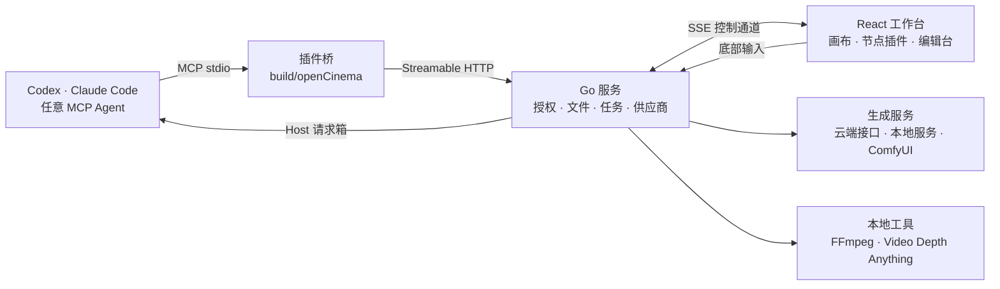

<p align="center">
  <picture>
    <source media="(prefers-color-scheme: dark)" srcset="assets/brand/logoDark.png">
    
  </picture>
</p>

<h3 align="center">你的 Agent，你的画布，你的电影。</h3>

<p align="center">
  本地优先的 AI 视频创作工作台。一张画布连接分镜、素材、白模预演、生成与剪辑，<br>
  你手动做的每一步，Agent 都能用同一套工具接着做。
</p>

<p align="center">
  <a href="LICENSE"></a>
  
  
  
  
  
</p>

<p align="center">
  <a href="readme.md">English</a> ·
  <strong>中文</strong> ·
  <a href="readmeJa.md">日本語</a>
</p>

<p align="center">
  <a href="https://opencinema.site">opencinema.site</a> ·
  <a href="#快速开始">快速开始</a> ·
  <a href="#功能">功能</a> ·
  <a href="roadmap.md">Roadmap</a> ·
  <a href="#架构">架构</a> ·
  <a href="#扩展-opencinema">扩展</a> ·
  <a href="#贡献代码">贡献</a> ·
  <a href="assets/promo/openCinemaLaunch.mp4">发布影片 · 30 秒</a>
</p>

<p align="center">
  
</p>
<p align="center"><sub>示例工程的真实界面截图。生成结果取决于你配置的模型、参考和审片。</sub></p>

## 为什么用 OpenCinema

生成工具回答“这段画面怎么生成”，OpenCinema 回答“这部片子怎么做完”。

- **先预演，再生成，只返修需要的镜头。** 用 3D 白模定走位和机位，审片后替换单镜，不用整片重来。
- **一张画布贯穿全片。** 分镜文本、参考素材、白模预演、生成、审片和剪辑计划都是画布上的节点，连线就是参考关系。
- **Agent 操作同一张画布。** 你在 Codex、Claude Code 或任何 MCP 客户端里描述要求，Agent 通过公开的 MCP 工具读写节点；你随时可以打开编辑台手工修改。两条路径共用同一套命令、修订和撤销历史。
- **生成后端可以换。** 云端模型、本地服务和你现有的 ComfyUI 工作流，都能接到同一个生成节点上。
- **一切在本机。** Go 服务只监听回环地址，工程是磁盘上的普通文件夹，凭据只留在本机设置里，Agent 只能看到“已配置”或“未配置”。

> **当前状态：0.4.0 开发中，尚未发布。** macOS 和 Linux 可以从源码构建，Windows 归档暂不支持。AI 生成使用你自己配置的供应商，可能计费。详见[已知限制](#已知限制)。

## 工作方式



Agent 先调用 `getAppState` 固定工程和画布，再按实时 Schema 发现工具并执行。有副作用的调用带 `operationId`，写画布带 `expectedRevision`；冲突时拒绝，结果未知时查询原操作，不盲目重试。

## 快速开始

### 1. 准备环境

| 工具 | 版本 | 用途 |
| --- | --- | --- |
| [Bun](https://bun.sh) | 1.3.14+ | 安装依赖、构建前端和插件 |
| [Go](https://go.dev/dl/) | 1.26+ | 编译本地服务 |
| [Node.js](https://nodejs.org) | 22+ | 仅接入 Claude Code 和 Codex 时需要；运行完整发行包也只需要它 |
| FFmpeg | 可选 | 音视频处理；没有的话可在 **设置 → FFmpeg** 下载 |
| Python | 3.10–3.12，可选 | 仅视频深度白模节点需要 |

### 2. 构建并启动

```bash
git clone https://github.com/junjamrk/OpenCinema.git
cd OpenCinema
bun install --frozen-lockfile
bun run build
bun start
```

打开 <http://127.0.0.1:47920>。服务只监听本机，配置和密钥保存在仓库下的 `data/`，已被 Git 忽略。

### 3. 打开工程

点击 **新建工程**，填写名称并选择位置；或点击 **打开工程**，浏览到已有文件夹。空文件夹也可以，会自动创建第一张画布。**导出工程** 生成的 ZIP 可以在新建工程对话框里用 **导入工程包** 恢复。之后可以从首页的最近工程一键回到它。

### 4. 选一种生成方式

两种方式可以同时用，节点上随时切换。

| | 配置媒体服务 | 连接 Agent |
| --- | --- | --- |
| 适合 | 直接调用模型生成 | 让 Agent 规划、搭画布、批量操作 |
| 需要 | 供应商 API Key 或本地服务 | Claude Code、Codex 或其他 MCP 客户端 |
| 费用 | 由供应商按量收取 | 宿主订阅不包含所有视频模型 |

**配置媒体服务**

1. 打开 **设置 → 媒体服务**，列表会显示每个供应商是否已配置。
2. 选择供应商，填写 API Key，保存连接配置。
3. 在生成节点上点击参数按钮，选择模型。

**连接 Agent**

<table>
<tr>
<td width="36%"></td>
<td valign="top">

Claude Code，在完成构建的仓库根目录运行：

```bash
claude --plugin-dir ./build/openCinema
```

Codex：

```bash
codex plugin marketplace add . --json
```

```bash
codex plugin add opencinema@openCinemaStandalone --json
```

然后告诉 Agent「连接 OpenCinema 工作台」，Claude Code 也可以直接用 `/opencinema:opencinema`。工作台右上角显示已连接后，底部输入框的要求就会交给 Agent 执行。

其他 MCP 客户端在 **设置 → 宿主 Agent** 复制连接配置，细节见 [Claude 接入](docs/claudeSetup.md)。
</td>
</tr>
</table>

> 保持工作台页面打开。画布和节点工具运行在页面里，Agent 通过它操作画布。

### 5. 做第一个镜头

1. 把一张图片拖到画布上。
2. 按 `Tab`，选择 **视频生成**。
3. 从图片节点右侧的端口拖一条线到视频生成节点左侧。
4. 选中视频生成节点，点击上方的参数按钮，选模型、时长和画幅。
5. 在底部输入框写下镜头要求，按 `⌘/Ctrl + Enter` 发送。

节点会显示进度，完成后视频保存到工程的 `assets/`。之后可以继续截帧、审片，或接到下一个节点。

### 一次典型的创作

1. 打开工程，拖入参考图、参考视频和音频，写一段简短说明。
2. 在 Blockout 里编排走位和镜头，导出本镜的 RGB 和 Depth，固定为参考节点。
3. 把说明、静帧和预演接进视频生成节点，设置参考职责。
4. 在底部输入框写要求，例如“追逐再紧张一点”。Agent 先给出生成计划，确认后生成候选。
5. 逐条审片，拒收的片段保留在工程里。
6. 在剪辑计划里只替换没通过的镜头，加上音轨，渲染新成片。

### 遇到问题

| 现象 | 处理 |
| --- | --- |
| 发送按钮是灰的 | 看输入框下方的提示，直接点连接 Agent 或配置模型 |
| 节点里没有可选模型 | 到 **设置 → 媒体服务** 配置，或添加自定义供应商 |
| 音视频处理报错 | 到 **设置 → FFmpeg** 下载，或切换为系统安装版 |
| 端口 47920 被占用 | 运行 `build/server/openCinema -listen 127.0.0.1:47921 -webRoot build/web -dataDirectory data` |
| Agent 报“请先连接工作台” | 打开工作台页面并进入工程，再让 Agent 重新读取状态 |

## 功能

### 画布与 13 个节点插件

<table>
<tr>
<td width="34%"></td>
<td valign="top">

按 <kbd>Tab</kbd> 打开节点面板，或直接把文件拖进画布。节点按端口类型连线，连进生成节点的素材会显示为带序号的参考。

| 分类 | 节点 |
| --- | --- |
| 文本与媒体 | 文本 · 图片 · 视频 · 音频 |
| 生成 | 图片生成 · 视频生成 · 音频生成 |
| 空间与摄影 | Blockout · 3D 导演 |
| 分析 | 视频分析 · 媒体信息 · Motion · 视频深度白模 |
| 工作区扩展 | 多人协作 |

多画布、分组、对齐参考线、网格吸附、自动整理、批量连线和撤销重做都是内建能力，Agent 与手工共用。快捷键和节点菜单可以在设置中自定义。
</td>
</tr>
</table>

### 你决定 Agent 的操作范围


选中一个节点，底部输入只作用于它；框选一组节点，范围就是这些节点；什么都不选，就是整张画布。生成节点还能在生成和让 Agent 调整节点之间切换。

### 素材编辑台

<table>
<tr>
<td width="68%"></td>
<td valign="top"></td>
</tr>
</table>

所有操作都生成新副本或新节点，原素材保留。

- **图片**：画笔或框选局部重绘、标记、裁剪与变换、宫格切分、打光、机位和全景。打光和机位的结果会转成生成草稿。
- **视频**：截取为新节点、截首帧尾帧或当前帧、提取音轨、分离音视频、变速、视频分析、语音转写，以及审片和剪辑计划入口。
- **音频**：波形剪辑、片段拼接、变速和语音转写，通过本机 FFmpeg 处理。

### Blockout：先看清镜头，再生成


在白模舞台上摆放人物与物体、编排走位、录制相机运动，按镜头导出 RGB、Depth、Normal 层和整场 Animatic。固定后的导出会变成参考节点接进视频生成。3D 导演节点可以根据文字生成动画方案，再由你手动取景。

白模和相对深度是**参考**，用于构图和运动节奏。普通视频参考不保证模型严格复现运动。

### 分析

- **视频分析**：检测切点，拆成关键帧、镜头片段和音轨，不需要 Python 或模型 API。
- **Motion**：最长 30 秒视频的姿态骨架和二维运动分析，可选相对深度，可导出制作包。它不是 3D 相机解算。
- **视频深度白模**：用本机准备的 Video Depth Anything Small 生成时序相对深度，构建不会自动下载模型。
- **媒体信息**：本地读取编码、时长、帧率和轨道，不上传文件。

### 生成计划、审片与剪辑计划

- **生成前看计划。** `getGenerationPlan` 返回最终提示词、实际模型参数和每条参考的职责，不付费、不提交。
- **审片是人的记录。** 逐项检查方向、动作、身份、空间连续、意外切镜和形变。拒收或未审的片段不能进入合成，软件不替你判断质量。
- **只换有问题的镜头。** 剪辑计划保存 2–16 镜的顺序、入出点、规格和一条音轨。替换一镜时其余镜头不动，渲染生成新的成片节点。

完整流程见[镜头工作流](docs/videoShotWorkflow.md)。

### 你的模型，你的工具

<table>
<tr>
<td width="36%"></td>
<td valign="top">

图片、视频和音频生成都有两条路：交给宿主 Agent，或直接调用配置好的模型。

| 供应商 | 图片 | 视频 | 音频 |
| --- | --- | --- | --- |
| TF-router | ✓ | ✓ | ✓ |
| APIMart | ✓ | ✓ | |
| 优云智算 | ✓ | ✓ | |
| 秘塔 MiniMax H3 | | ✓ | |
| 火山方舟 Seedance | | ✓ | |
| fal | ✓ | ✓ | ✓ |
| Replicate | ✓ | ✓ | ✓ |
| 本地／局域网视频服务 | | ✓ | |
| ComfyUI 工作流 | ✓ | ✓ | ✓ |
| 自定义 | ✓ | ✓ | ✓ |
</td>
</tr>
</table>

- **fal 和 Replicate 预置模型**：fal 预置 Kling、FLUX 和 ElevenLabs，Replicate 预置 Veo、FLUX 和 MiniMax Speech，其他模型在设置中添加。
- **任务不怕重启**：页面断线或服务重启后，fal、Replicate、方舟、OpenAI 风格服务、ComfyUI、`httpTask` 和 `adapter` 恢复观察原任务，不会重复提交收费请求。产物下载到工程内，经 FFprobe 校验后才算成功。
- **FFmpeg**：使用系统安装版，或按平台 SHA 校验下载。执行命令经过过滤器和参数白名单。
- **凭据**只在本机设置面板录入。配置了凭据不代表已鉴权、已授权计费或生成已验证。

详见[视频供应商文档](docs/videoProvider.md)。

### 接入 ComfyUI 工作流

ComfyUI 负责生成，OpenCinema 把每个工作流当成一个模型，不用写清单：

1. 在 ComfyUI 里跑通工作流，然后选择 **Export (API)**。普通的画布保存格式不能导入。
2. 打开 **设置 → 媒体服务 → ComfyUI 工作流**，启用连接，填写地址（默认 `http://127.0.0.1:8188`），点击 **保存并检测**。
3. 点击 **导入工作流**，确认哪个节点接收提示词，并把每个加载节点标记为首帧、尾帧、参考或保持原样。
4. 在生成节点里选择这个工作流。Agent 通过同一套节点工具使用它。

工作流按黑盒运行：只替换你确认过的输入，`seed` 和 `noise_seed` 每次提交都会更换，产物必须经保存节点输出。导入时可以追加画幅和时长，也可以勾选要在节点上调整的字段。

> 工作流运行在 ComfyUI 上，自定义节点可以执行任意代码，只导入你信任的工作流。Agent 工具不能新增或修改工作流，只有你能在设置页导入。

### 协作与工程管理

- **多人协作**：同一服务上的画布协作，支持限时编辑或只读邀请、本人撤销重做和断线恢复。不会启动公网服务，也不提供字符级协同。
- **素材库**：跨工程的全局素材，可拖到任意画布使用。
- **工程导出**：把工程打包下载，包含画布和素材。
- **历史版本**：媒体节点保留生成历史，可以随时切回。

## 架构

| 层 | 位置 | 职责 |
| --- | --- | --- |
| Go 服务 | `apps/server` | 授权与路径边界、原子写入、MCP 入口和 `operationId` 记录、媒体任务与供应商协议、FFmpeg 和深度模型、协作 |
| React 工作台 | `apps/web` | 画布（@xyflow/react）、节点视图、编辑台、工具目录、与 Go 的 SSE 控制通道 |
| 编辑会话 | `packages/workbenchCore` | 与框架无关的文档、修订、撤销重做和保存队列 |
| 节点 SDK | `packages/nodeScaffold` · `packages/nodeShared` | 插件合同、Zod 工具注册、构建产物，以及生成、审片、剪辑计划等跨插件业务 |
| 节点插件 | `packages/nodes/*` | 13 个内置节点、协作扩展和 Gaussian Splat 市场插件 |
| MCP 桥与插件包 | `packages/mcp` · `packages/openCinema` | stdio 适配、Widget 资源、启动器和租约、Codex 与 Claude 清单及 Skill |

三条不变量支撑整个设计：**Schema 只有一个来源**（Zod → JSON Schema → Go → stdio）；**人和 Agent 走同一条命令路径**，共用修订和撤销；**副作用可追溯**（`operationId` 幂等，`unknown` 不自动重试，产物带来源和审片记录）。

## 扩展 OpenCinema

### 开发节点插件

OpenCinema 大部分能力由插件提供，13 个内置节点也是插件。插件是运行在工作台页面里的 ESM 模块，通过端口交换数据，把能力发布成工具。按钮和 Agent 调用同一个工具，Agent 不用改协议就能发现它。

插件可以在仓库外开发。脚手架还没发布到 npm，先在仓库根目录打包：

```bash
cd packages/nodeScaffold && npm pack
```

在存放插件的目录生成工程，把 `<repo>` 换成实际路径：

```bash
npx --yes --package <repo>/packages/nodeScaffold/toonflow-nodes-scaffold-0.4.0.tgz createOpenCinemaPlugin helloNode --name "字数统计" --scaffold file:<repo>/packages/nodeScaffold/toonflow-nodes-scaffold-0.4.0.tgz
```

安装依赖、检查并构建：

```bash
cd helloNode && npm install && npm run typecheck && npm run build
```

然后打开 **设置 → 插件 → 安装插件包**，选择 `dist/install.json`。

<details>
<summary>示例：统计上游文本字数的节点</summary>

在 `package.json` 的 `openCinema` 块声明插件。`getService` 只返回 `requires` 里列出的服务：

```json
"openCinema": {
  "id": "helloNode",
  "name": "字数统计",
  "description": "统计上游文本的字数",
  "category": "文本与媒体",
  "requires": { "workbench": 1 }
}
```

`src/reactPlugin.ts`：

```ts
import { z } from "zod";
import type { NodePluginDefinition } from "@toonflow/nodes-scaffold/contracts";
import type { NodeWorkbenchService } from "@toonflow/nodes-scaffold/workbenchServices";
import { openCinema, version } from "../package.json";
import PluginView from "./reactView";

const plugin: NodePluginDefinition<typeof PluginView> = {
  ...openCinema, version, apiVersion: 1, renderer: "react", view: PluginView,
  createData: () => ({ label: openCinema.name, handles: [
    { id: "text", type: "target", dataType: "STRING", label: "文本" },
    { id: "count", type: "source", dataType: "STRING", label: "字数" },
  ], outputs: {} }),
  activate(context) {
    const workbench = context.getService<NodeWorkbenchService>("workbench");
    context.registerTool({
      name: "countText", description: "统计上游文本的字数，并写入字数输出。",
      parameters: z.strictObject({}),
      outputSchema: z.strictObject({ count: z.number().int().nonnegative() }),
      annotations: { readOnlyHint: false, destructiveHint: false, idempotentHint: true, openWorldHint: false },
      async execute(_args, { signal }) {
        workbench.assertWritable();
        const text = workbench.getInputs("text").map(input => String(input.value ?? "")).join("");
        await workbench.updateData({ outputs: { count: { dataType: "STRING", value: String(text.length) } } }, undefined, signal);
        return { count: text.length };
      },
    });
  },
};

export default plugin;
```

`src/reactView.tsx`：

```tsx
import type { ReactNodeViewProps } from "@toonflow/nodes-scaffold/react";

export default function PluginView({ node, controller, readOnly }: ReactNodeViewProps) {
  const outputs = node.data?.outputs as { count?: { value?: string } } | undefined;
  return <div className="nodrag">
    <button type="button" disabled={readOnly} onClick={() => void controller.callNodeTool(node.id, "countText", {})}>统计</button>
    <span>{outputs?.count?.value ?? "尚未统计"}</span>
  </div>;
}
```

安装后，节点面板里会出现 **字数统计**，`getNodeTools` 也会返回 `node:countText` 及其 Schema。
</details>

<details>
<summary>插件结构与代码归属</summary>

| 部分 | 作用 |
| --- | --- |
| `createData` | 节点初始数据和端口，端口类型包括 `STRING`、`IMAGE`、`VIDEO`、`AUDIO`、`FILE` |
| `view` | React 视图 |
| `registerTool` | 用 Zod 参数发布工具 |
| `composer` | 可选，接入底部输入框 |
| `requires` | 需要的服务和宿主能力，例如 `workbench`、`workspaceFiles`、`ffmpeg` |
| `category`、`description` | 节点在节点面板里的分组和说明 |
| `onDispose` | 释放 Worker、监听器等资源 |

节点专属逻辑放在所属插件包，多个插件共用的逻辑放 `packages/nodeShared`，通用合同放 `packages/nodeScaffold`。

要作为内置节点发布，把工程移到 `packages/nodes/<id>/`，从 `@toonflow/nodes-scaffold/reactBuild` 引入构建配置，设置 `outDir: "../../../build/nodes/<id>"`，在 `openCinema` 块加上 `order`，把工作区依赖加到 [`apps/web/package.json`](apps/web/package.json)，再运行 `bun run generate:nodes`。
</details>

插件也可以提供生成服务：在 `viteConfig.ts` 里声明 `providers`，格式与下面的清单相同，安装时走同一套校验。

> 已安装的插件运行在页面里。`requires` 只限制 `getService`，不是沙箱，插件仍可读写工作区，只安装你信任的插件包。

完整合同见[节点 SDK](packages/nodeScaffold/readme.md)。

在本仓库内新增插件时运行 `bun packages/nodeScaffold/scripts/createNode.ts myNode "我的节点"`。它生成可直接编译、安装的骨架，含写给 Agent 的 `agent.md`，随 manifest 发行，Agent 通过 `getPluginConfiguration` 读取。约定见[插件开发指南](docs/pluginDevelopment.md)。

### 插件市场

[opencinema.site/market](https://opencinema.site/market/) 是一份静态目录。工作台在 **设置 → 插件 → 插件市场** 下载插件包，按目录中的 SHA-256 校验，显示复核卡片，再由本机服务安装。Agent 用 `getPluginMarket` → `installMarketplacePlugin` 完成同样的事。市场目前只支持安装，发布时通过 Pull Request 把条目加入 `site/src/marketCatalog.json`。

第一个市场插件是 [Gaussian Splat](packages/nodes/gaussianSplatNode/readme.md)：在画布中查看 3D Gaussian Splatting 扫描（PLY / SPLAT / KSPLAT / SPZ），设定机位，渲染静帧与环绕视频作为参考。它不是内置节点，three.js 和 GaussianSplats3D 的 3D 能力都通过插件链路装入，说明第三方节点与内置节点走的是同一条路。

### 接入生成服务

如果服务符合下面的协议之一，写一份 JSON 清单就够了：

| 字段 | 服务形态 |
| --- | --- |
| `videoProtocol: "openaiVideo"` | multipart 提交、按 ID 查询、下载内容的视频任务接口；本地或自建服务都可以 |
| `videoProtocol: "fal"` | fal 队列 |
| `videoProtocol: "replicate"` | Replicate predictions |
| `videoProtocol: "httpTask"` | 任意任务式 HTTP 服务。在清单里声明认证、提交、轮询、状态映射和产物路径，不用写代码 |
| `videoProtocol: "adapter"` | 你自己的本机程序，通过 stdin 和 stdout 交换 JSON，适合请求签名这类流程 |
| `protocol: "openai"` | `images/generations` 风格的图片接口 |
| `endpoints.image` 等 | 返回结果地址的同步 JSON 接口 |

打开 **设置 → 媒体服务** 添加自定义供应商。从模板改起，换掉地址和模型 ID，校验清单后添加，再到连接配置里填 API Key。不要把凭据写进清单，服务端会拒绝。

<details>
<summary>清单示例</summary>

```json
{
  "id": "remoteVideo",
  "label": "我的视频服务",
  "apiUrl": "https://video.example.com/v1",
  "videoProtocol": "openaiVideo",
  "transport": "public",
  "cancelMode": "none",
  "endpoints": { "video": "videos" },
  "rules": [{ "field": "apiKey", "title": "API Key", "type": "input", "value": "", "props": { "type": "password" } }],
  "models": [{
    "id": "deployedModelName",
    "label": "已部署的视频模型",
    "type": "video",
    "mode": ["text", "endFrameOptional"],
    "imageRatios": ["16:9", "9:16"],
    "audio": false,
    "durationResolutionMap": [{ "duration": [4, 8], "resolution": ["720p"] }],
    "video": { "inputMap": { "firstFrame": "input_reference" } }
  }]
}
```
</details>

- 连本机或局域网服务时，把 `transport` 设为 `"local"`，使用明确的 IP 和端口。API Key 可选，图片、视频和音频都支持。
- 模型可以声明 `parameters`（JSON Schema 子集），节点据此生成表单，Agent 读写同一份值。
- `adapter` 可执行文件必须手动放到数据目录的 `providerAdapters/<供应商 ID>/` 下，清单不能声明命令。

详见[视频供应商文档](docs/videoProvider.md)。

### Agent 工具面

| 层级 | 发现方式 | 内容 |
| --- | --- | --- |
| 核心工具 | `tools/list` | `getAppState`、`renderOpenCinema`、画布读写、`workspaceFiles`、`readWorkspaceImage`、`getOperation`、Host 请求箱 |
| 工作台扩展 | `getWorkbenchTools` → `workbenchTools` | 分组、整理、画布管理、素材库、供应商和插件管理、FFmpeg 与深度模型配置 |
| 节点和工作区插件 | `getNodeTools` / `getWorkspaceTools` → `nodeTools` / `workspaceTools` | 镜头计划、生成、审片、剪辑计划、Blockout、运动分析等专业功能 |

每一层都有实时 Schema、输出校验和 `annotations`，错误带机器可读的代码和恢复动作。支持 MCP Apps 的宿主可以用 `renderOpenCinema` 在对话里打开工作台。详见 [MCP SDK](packages/mcp/README.md) 和[插件说明](packages/openCinema/readme.md)。

### 发行包

`bun run release` 把已有的 `build/openCinema` 打包成 `openCinema-<version>-<platform>-<arch>.zip`，附带校验和与清单。解压后的目录只需要 Node.js 22+ 就能作为插件加载。详见[发行指南](docs/releaseGuide.md)。

## 贡献代码

```bash
bun install --frozen-lockfile
```

```bash
bun run dev:web
```

```bash
bun run dev:server
```

提交 Pull Request 前运行：

```bash
bun run typecheck
```

```bash
bun run build
```

- **先读[贡献指南](contributing.md)**：新文件和文件夹用小驼峰，React 组件标签用 PascalCase，画布改动走公开命令或 MCP 工具，文件操作走 `@toonflow/file`。
- **说明改动**：问题、最终行为和实际运行过的命令。界面改动附前后截图，Agent 能力附调用和读回结果，媒体任务附真实产物规格。模板：[Pull Request](docs/pullRequestTemplate.md)、[Issue](docs/issueTemplate.md)。
- **不要提交** `build/`、`data/`、凭据、个人素材或本机绝对路径。
- **不要新增测试文件**：本仓库的测试另行负责，请用类型检查、构建和手动验证。
- **新增依赖**：说明原因和许可证，保留锁文件，并更新[第三方声明](thirdPartyNotices.md)。
- **欢迎的方向**：节点和供应商示例、工具描述与界面的英文化、文档和教程、大画布与媒体预览的性能、Windows 验证。

安全问题按 [security.md](security.md) 处理，社区互动遵守[行为准则](codeOfConduct.md)。[Issues](https://github.com/junjamrk/OpenCinema/issues) · [变更记录](changelog.md)

## 发布影片

[观看 30 秒发布影片](assets/promo/openCinemaLaunch.mp4)。影片中的界面与画面全部由代码绘制，不含模型生成的镜头。[分镜脚本](docs/launchVideoStoryboard.md)和[源码](assets/promo/launchVideo/readme.md)在仓库中。更早的 58 秒产品概念片见 [assets/promo/openCinemaPromo.mp4](assets/promo/openCinemaPromo.mp4)。

## 已知限制

- 节点和画布工具运行在工作台页面里。页面关闭时，Agent 能操作工程文件，但不能运行节点。
- 已安装的插件没有沙箱。`requires` 只限制 `getService`，插件仍运行在页面里。
- ComfyUI 的进度只反映当前节点，不是整个工作流。上传的参考素材留在它的 `input` 目录，因为 ComfyUI 没有删除接口。ComfyUI 重启后会丢失任务记录，这类任务显示为未确认，不会自动重新提交。
- 报价和余额查询目前只有 TF-router 支持。实际成本来自余额差，同账户任务重叠时显示为未知。
- 发行归档必须匹配你的系统和 CPU 架构。宿主、供应商和平台分别验证，构建通过不代表所有功能可用。

## 许可与致谢

[MIT](LICENSE)，保留 HBAI-Ltd 版权声明。Blockout 和 Motion 改编自 Sam Wasserman 的同名工具（Apache-2.0）。字体、图标、模型权重、FFmpeg 构建和用户素材遵循各自条款，见[第三方声明](thirdPartyNotices.md)。分发和文档方式参考了 [Cowart](https://github.com/zhongerxin/Cowart)。
